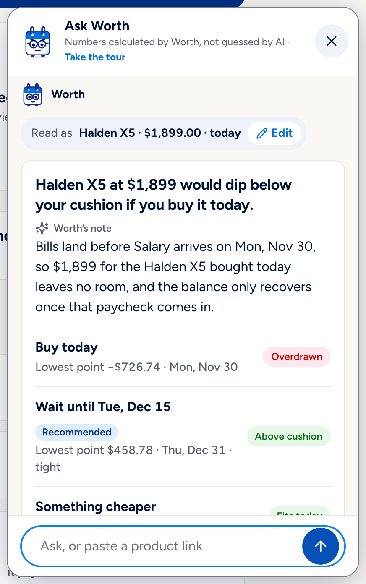
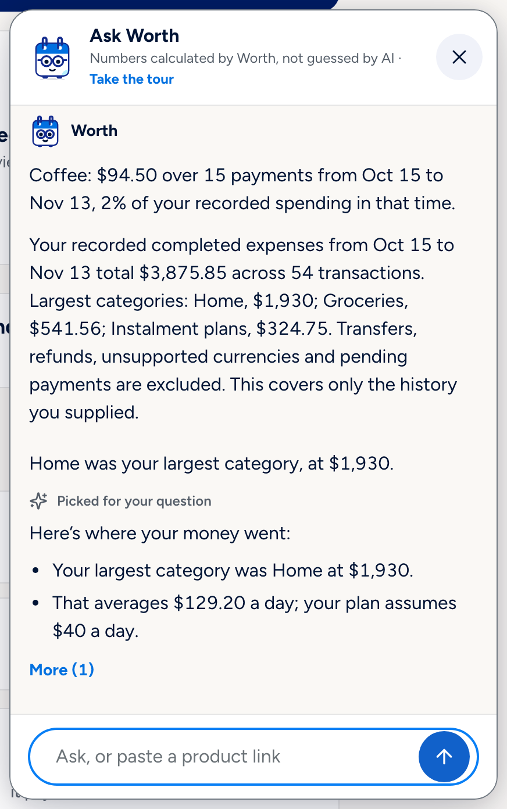
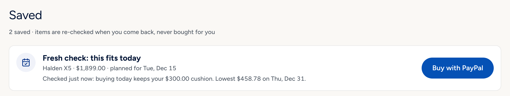
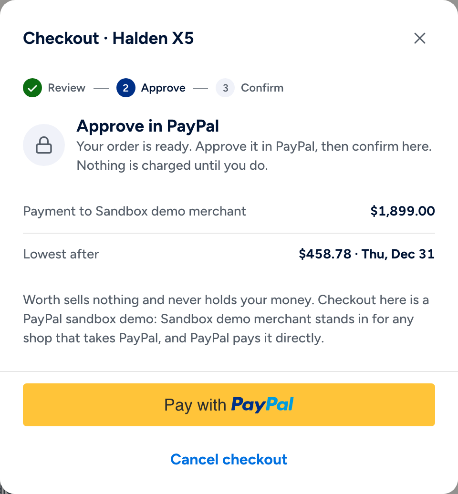
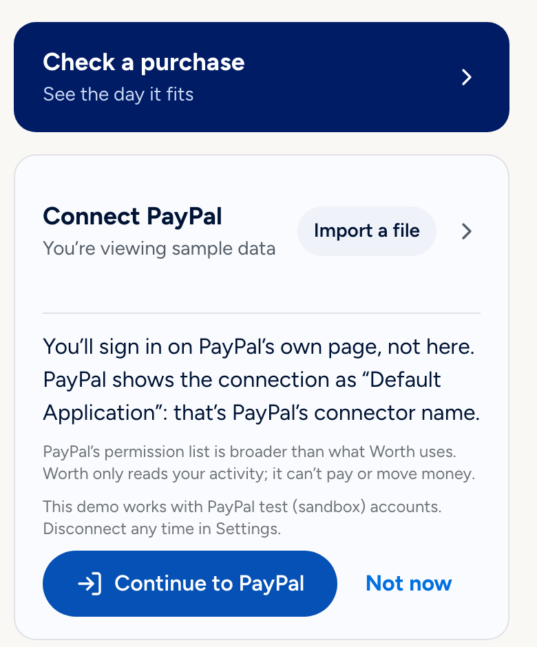
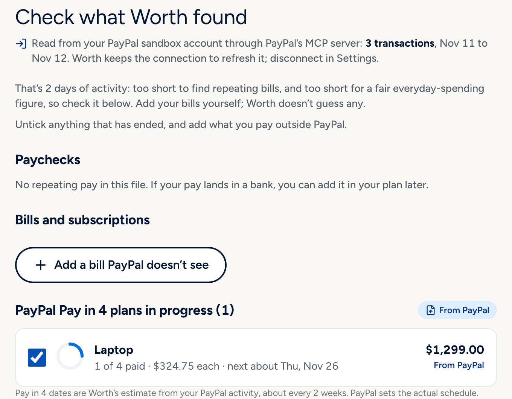
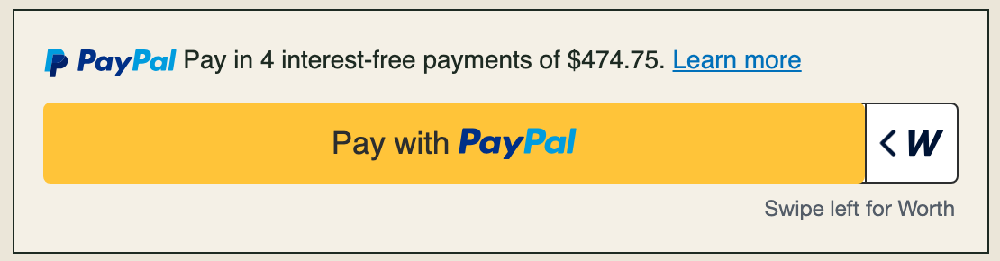
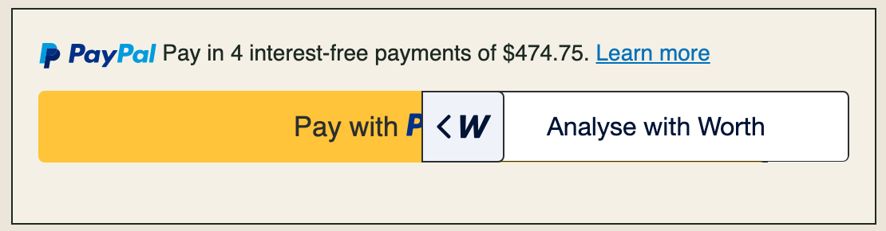
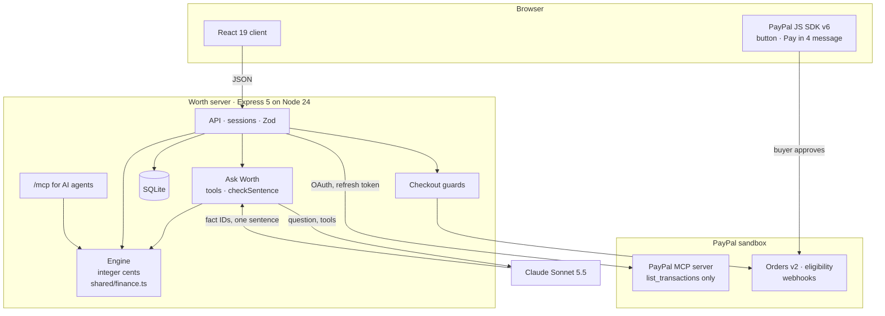

# Worth

**Your balance says you can. Worth tells you the day you actually can.**

Before you buy something, Worth checks it against your bills, your paydays, the Pay in 4 plans
you already have running and the cushion you want to keep. Then it tells you whether to buy today,
wait until a named day, or spend less. When that day comes, you pay with PayPal.

**Live app:** https://worth.onrender.com (no sign-in; opens on a sample month)<br>
**Demo video:** `TODO(YouTube link)`<br>
**Licence:** MIT


Worth is an independent hackathon project built for the PayPal AI Hackathon. It is not a PayPal
product and is not endorsed by PayPal. It runs against the PayPal sandbox only, and it is not
financial advice.

## The problem

A balance tells you what is in the account, not what is already spoken for. Rent, a car payment
and the next payment on something bought with Pay in 4 are all still coming. So the useful
question at checkout is not "do I have $1,899?" but "what does $1,899 today do to the rest of my
month, and if not today, when?". Pay in 4 makes that harder to see, because the same total arrives
as four payments and one of them can land the day after rent.

## How it works: Alex and a $1,899 camera

Alex is the sample person every visitor starts as. It is Fri, Nov 13, 2026. He has $2,540 and
wants the Halden X5, a $1,899 camera (Halden is an invented brand). His balance says yes.

### 1. Home: what is safe to spend today

The card at the top of this page is Alex's Home. Worth projects his balance day by day and works
out the most he could spend today and still pay every bill and keep his $300 cushion: **$872.26**,
not $2,540. The bar splits his money into what is free, what is needed by his next payday (Nov 30)
and the cushion. Below it, Worth points out when a running Pay in 4 payment lands next to a bill.

A first visit starts a six-step tour of Home. **Take the tour** in the top bar replays it.


### 2. Ask Worth: "Can I afford the $1,899 Halden X5?"

**Check a purchase** opens Ask Worth, a chat panel available on every screen. Alex types the
question in his own words. Worth shows how it read the question (Halden X5, $1,899.00, today) so
he can correct it, then the answer: buying today puts him below his cushion; waiting until
Tue, Dec 15 keeps it. Claude wrote the short "Worth's note"; every figure in it and in the
options below it comes from Worth's engine.



If Alex asks about another day ("Can I buy it next Friday?"), the answer's **See the comparison**
link carries that day, and the comparison opens on buying in full that day.

### 3. The comparison: buy today, wait, or spend less

**See the comparison** opens the answer page. The verdict comes first: **Wait until Tue, Dec 15**.
Buying today takes Alex below his cushion from Thu, Nov 19 and below zero the next day; the card
says **Overdrawn**, lowest −$726.74. Waiting keeps him $158.78 above the cushion (lowest $458.78
on Thu, Dec 31). Something cheaper fits today up to $872.26. Worth finds the wait date by trying
every day in the next 35 and judging each over the same 60-day window.


### 4. The balance chart

Under the cards, a chart draws each option's projected balance. The pills above it are the
options: the recommended one is pressed when the page opens, and pressing **Buy today** adds that
line. The dotted line is the cushion, red shading marks every stretch below it, and thin green and
red lines mark days money comes in and goes out. A range control switches between To payday, 30
days and 60 days, a panel explains the day under the pointer, and **View as table** lists the same
values. The chart computes nothing itself; every value is the engine's.


### 5. Ask Worth can show you on the chart

On the comparison, Ask Worth can answer questions about the chart and change what it shows. Asked
"What does the red shading mean if I buy it today?", it explains the cushion line and the shading,
names the two stretches below the cushion, presses **Buy today** on the chart and pins Thu, Nov 19,
the first day below it. It can change only the pills, the range and the day in focus; it cannot
buy, save or leave the page.


### 6. PayPal Pay in 4, payment by payment

**Compare with PayPal Pay in 4** splits $1,899 into four payments of $474.75 and places each one
against the nearest bill. With Pay in 4 from today, Alex would still go below his cushion on Sun,
Nov 29 (lowest $222.76 on Mon, Nov 30), because payment 2 lands about two days after his car
insurance. The panel also counts the laptop plan he already has running ($974.25 still due in the
window) and shows PayPal's own Pay in 4 message. Worth shows Pay in 4 for comparison only and
never recommends it.

![The Pay in 4 panel: a warning that the balance would first go below the cushion on Sun, Nov 29, lowest $222.76 on Mon, Nov 30; four payment cards of $474.75 (today; about Fri, Nov 27, about 2 days after car insurance; about Fri, Dec 11, about 1 day after student loan; about Fri, Dec 25, the same day as car insurance); Already running: Laptop · Pay in 4, $324.75 on Nov 20, Dec 4 and Dec 18; a note that 1 plan has $974.25 due in this window; PayPal's message "Pay in 4 interest-free payments of $474.75"](docs/img/pay-in-4.png)

### 7. Other questions about the month

Ask Worth also answers questions that are not about one purchase. "Am I spending too much on
coffee?" gets the server's own sum: $94.50 over 15 payments in the last 30 days, 2% of Alex's
recorded spending, with no verdict on "too much". "When do I get paid next?" gets Mon, Nov 30,
Salary, $3,900. "What bills are coming up?" lists them. The **Plan** page has the same month as
tabs: Bills, Subscriptions, Pay in 4, Income and Next 30 days.



### 8. Save it for the day it fits, then pay with PayPal

**Save for Tue, Dec 15** keeps the camera in Saved with its date; nothing is bought. Worth has no
scheduler and sends nothing: when Alex comes back on that day, Saved runs a fresh check against
that day's balance. To see that day without waiting a month, open
https://worth.onrender.com/?replay=demo-dec15.



**Buy with PayPal** checks once more, then creates a PayPal sandbox order and opens PayPal's own
button. Alex approves in PayPal's window and confirms in Worth; only then does Worth capture the
payment. The payee is a neutral sandbox merchant; Worth sells nothing and never holds money.



### 9. Your own PayPal activity: Connect PayPal

Alex is sample data. **Connect PayPal** lets you use your own (sandbox) PayPal account instead.
Worth explains first that you sign in on PayPal's own page and that Worth only reads activity.



After you sign in, Worth reads your recent transactions through PayPal's MCP server and shows what
it found for you to confirm: repeating bills and paychecks if there is enough history, and Pay in
4 plans in progress. Each row is tagged **From PayPal** or **You added**, and you enter the things
PayPal can't know, such as money available and your cushion. The sandbox account below has one
real sandbox purchase, a $1,299 laptop paid with Pay in 4.



You connect once. Worth keeps PayPal's refresh token on the server, encrypted, and when you open
the app and the last read is more than 15 minutes old it reads PayPal again in the background. It
only adds: new transactions, a new Pay in 4 plan, a Pay in 4 payment PayPal shows as made. It
never changes what you entered. **Settings → Disconnect PayPal** ends the connection and keeps your
plan. A PayPal activity CSV export works too, through **Import a file**.

### 10. A shop can add Worth to its PayPal button

`merchant/` holds a separate example shop, Larkspur Supply (invented), to show how a store could
hand a shopper to Worth before they pay. The shop keeps PayPal's button exactly as it is; Worth's
"W" tab sits on its right edge. Swiping the tab left (or tapping it) opens Worth's check for that
item with a price the shop's server signed; Worth tells the shopper the day it fits and sends them
back. The hosted Worth app does not link to the shop; it runs locally (see
[Run it locally](#run-it-locally)).

<p>


</p>

AI agents can ask Worth too. **Settings → Connect an agent** creates a revocable token for Worth's
own MCP server (`/mcp`), so an assistant such as Claude Desktop can check a purchase against your
plan before it pays. It has no tool that pays or creates an order. See [docs/MCP.md](docs/MCP.md).

## How PayPal is used

Every call goes to the PayPal **sandbox**. The server holds the credentials; the browser receives
only the public client ID.

- **Connect PayPal through PayPal's hosted MCP server.** PayPal offers no public API that gives a
  third-party app a shopper's own activity, so Worth uses PayPal's MCP server
  (`mcp.sandbox.paypal.com`) with OAuth 2.1, PKCE and a single-use `state` bound to the session.
  The server calls one tool, `list_transactions`, over about six months, and refuses every other
  tool name before any request is made (`ALLOWED_TOOLS` in `server/paypalConnect.ts`), because the
  same token could also send invoices. The refresh token is sealed with AES-256-GCM under
  `PAYPAL_TOKEN_KEY` and stored with the session; access tokens stay in memory. No token reaches
  the browser, a log or Claude. Disconnect deletes Worth's copy and asks PayPal to revoke it.
- **JS SDK v6 checkout.** The `paypal-payments` component renders PayPal's own button and opens
  a one-time payment session from the click. Approval only updates the screen; capture is a
  separate step the user confirms in Worth.
- **Orders v2.** Create, get and capture, with `PayPal-Request-Id` derived from Worth's purchase
  ID so retries are idempotent. Every returned order is checked for reference, payee, currency,
  amount and capture count before Worth trusts it.
- **Pay in 4 awareness.** The server asks `find-eligible-methods` whether Pay Later applies to the
  price (Worth's own $10 to $2,000 range applies on top), the `paypal-messages` component shows
  PayPal's own Pay in 4 message beside Worth's comparison, and Worth reads existing Pay in 4 plans
  out of the shopper's activity. PayPal's order does not say whether the buyer chose Pay in 4, so
  after a purchase Worth asks.
- **Webhooks.** Signature-verified with `verify-webhook-signature`. Order events go through the
  same reconciliation as capture; a refund or reversal becomes a review item.
- **The swipe on the PayPal button.** In the example shop, `<worth-check mode="swipe">` wraps the
  shop's own `<paypal-button>` without covering or changing it (`shared/worthSwipe.ts`).

## How AI is used

Claude reads the question and chooses what to show. Worth's engine computes every number. Claude
never moves money.

- **Claude reads the question.** Ask Worth sends the message to Claude Sonnet 5.5
  (`claude-sonnet-5-5`, Anthropic SDK) with a fixed set of read-only tools: read a purchase, list
  bills, summarise spending, summarise the plan, find similar items, link to Worth's comparison for
  a listed item, and, on the comparison page, `show_on_chart`. The server checks Claude's reading
  against the user's own words: an amount that isn't in the message, a currency other than USD or a
  date beyond the next 35 days gets a question back instead of an answer.
- **The engine computes, in integer cents.** `shared/finance.ts` is plain TypeScript with no AI in
  it. It starts from today's money, adds paydays, subtracts bills, subscriptions, everyday
  spending and instalments, and keeps each day's low point. Home, Ask Worth, the comparison, the
  chart, checkout and the MCP server all read the same functions, and a test pins Alex's story to
  the cent. Totals such as the coffee answer are summed by the server, not by Claude.
- **Claude picks facts; the server writes them.** Each tool asks Claude for up to three of the
  engine's facts, by ID, with a reason for each. The server writes each fact's sentence from the
  engine's values.
- **The one free sentence is checked.** Claude may add one sentence of up to 30 words that names
  figures, dates and bills only through placeholders. `checkSentence` (`server/narration.ts`)
  rejects free numbers or dates, advice, wording that rates Pay in 4 and anything that contradicts
  the engine's outcome; on any failure the engine's own sentence is shown instead. The verdict is
  always a template.
- **The chart tool changes the view only.** `show_on_chart` takes one to three fact IDs and a view
  (pills, range, day in focus) from lists built for that item; the server validates each field and
  the browser applies it through `src/chartControl.ts`.
- **Asked to buy, it links.** Claude has no tool that pays, captures, creates an order, saves or
  edits the plan. Asked to buy a listed item, it links to Worth's comparison, where the person
  presses the buttons.
- **Without Claude** (no key, an error, a rate cap, or AI sharing off for imported data) every
  answer still works and is labelled as Worth's own calculation.

The AI path is replayed from recorded Claude responses in the test suite and can be run live
against the model; method and results are in [docs/EVALUATION.md](docs/EVALUATION.md).

## Architecture



- `shared/` is the engine and the types both sides use. `server/` owns sessions, every guard and
  every PayPal and Anthropic call. `src/` renders Home, Ask Worth, the comparison, the chart and
  checkout, and mounts PayPal's components unmodified.
- One Node 24 service on Render, with SQLite on a persistent disk. Each browser gets an anonymous
  session, kept for 24 hours unless the user opts in to 30 days.
- Under Spend less, Worth lists similar, cheaper products from other stores through Channel3.
  They link out; Worth does not sell them.

[docs/ARCHITECTURE.md](docs/ARCHITECTURE.md) has the full design: the forecast, the AI boundary,
Connect PayPal, the payment state machine, the shop hand-off and privacy.

## Run it locally

You need Node.js 24 and npm. SQLite is built into Node.

```sh
git clone https://github.com/iAnmolAgarwal/worth.git
cd worth
npm ci
npm run dev
```

Open http://localhost:5173. With no keys the whole engine works: Ask Worth answers with labelled
local calculations, checkout runs as a labelled simulation, and similar items are hidden.

To add keys, copy `.env.example` to `.env` and fill in what you have. Never commit `.env`.

| What | Variable names |
| --- | --- |
| Claude | `ANTHROPIC_API_KEY`, `ANTHROPIC_MODEL` |
| PayPal sandbox | `PAYPAL_CLIENT_ID`, `PAYPAL_CLIENT_SECRET`, `PAYPAL_WEBHOOK_ID`, `PAYPAL_BRAND_NAME`, `PAYPAL_NEGATIVE_TESTING` |
| Connect PayPal | `PAYPAL_CONNECT`, `PAYPAL_TOKEN_KEY`, `PAYPAL_MCP_CLIENT_ID` |
| Channel3 | `CHANNEL3_API_KEY`, `CHANNEL3_MODE`, `CHANNEL3_DAILY_LIMIT`, `CHANNEL3_IP_HOURLY_LIMIT` |
| Server | `PORT`, `HOST`, `APP_ORIGIN`, `TRUST_PROXY`, `DATABASE_PATH`, `NODE_ENV`, `MAX_HEAP_MB` |
| Limits | `CLAUDE_DAILY_LIMIT`, `CLAUDE_IP_HOURLY_LIMIT`, `SESSION_IP_HOURLY_LIMIT`, `MAX_SESSIONS`, `MAX_TRANSACTIONS`, `MCP_IP_PER_MINUTE`, `MCP_TOKEN_PER_MINUTE` |
| Example shop | `HANDOFF_SECRET`, `MERCHANT_ORIGIN`, `HANDOFF_MERCHANT_ID`, `WORTH_ORIGIN`, `MERCHANT_PORT` |

`.env.example` explains each one. PayPal credentials come from a sandbox REST app on a US business
account in the [PayPal developer dashboard](https://developer.paypal.com/dashboard/).

To run the example shop with the swipe, start Worth with `npm run dev` and the shop with
`npm run dev:merchant` in a second terminal, with the same `HANDOFF_SECRET` for both and
`MERCHANT_ORIGIN` and `WORTH_ORIGIN` pointing at each other.

Other scripts: `npm run build`, `npm start` (production server), `npm run mcp:stdio` (the MCP
relay for local agents) and `npm run eval:live` (the live AI evaluation).

## Try it as a judge

1. Open https://worth.onrender.com. You are Alex, the sample person, on Fri, Nov 13, 2026. All of
   his data is sample data. A six-step tour starts; **Skip** ends it.
2. Choose **Check a purchase** and tap "Can I afford the $1,899 Halden X5?". The answer is wait
   until Tue, Dec 15.
3. Choose **See the comparison**. Press **Buy today** on the chart, then ask Ask Worth "What does
   the red shading mean if I buy it today?". Open **Compare with PayPal Pay in 4**.
4. Choose **Save for Tue, Dec 15**, then open https://worth.onrender.com/?replay=demo-dec15 to
   jump to that day. Saved says "Fresh check: this fits today"; **Buy with PayPal** opens PayPal's
   sandbox checkout.
5. To try Connect PayPal or approve the checkout, sign in with the PayPal **sandbox** buyer:
   `TODO(buyer login: see Devpost testing notes)`. Use sandbox accounts only. To return to Alex
   afterwards: **Settings → Delete my data now**.

A sandbox account holds only what was done in the sandbox, so it has a short history with no
paydays. Until you add money available and a payday, Home can read "Short by …": that is the
projection without income, not an error.

## Tests

`npm run check` runs oxlint, TypeScript, the Vitest suite and the production build; GitHub Actions
runs it on every push and pull request. It needs no keys and no network. The suite covers the
engine's dates and edge cases, Alex's story to the cent, CSV and Connect PayPal import, the
background sync rules, checkout reservation, capture and webhooks against a fake PayPal, the
checkout guards, `checkSentence` as table tests, the chart and its guide, the MCP contract,
recorded Claude replies replayed through the real server, and the screens. `npm run test:e2e`
runs Playwright against Worth and the example shop on two origins.

## Limits and honesty

- **Sample data.** Alex, his bills, the Halden brand, the products and Larkspur Supply are
  invented. Alex's month is pinned to Fri, Nov 13, 2026 so it reads the same whenever it is
  opened; your own data always uses today's date.
- **Sandbox only.** No real money moves and nothing ships. Worth's own checkout covers seven
  listed sample items and pays a neutral sandbox merchant.
- **Not a PayPal product.** Worth is an independent hackathon project. PayPal's marks appear only
  inside PayPal's own components and screens.
- **Not financial advice.** Worth projects a balance from what you tell it and what PayPal shows.
  Its Pay in 4 schedule is an estimate (payments about every two weeks); PayPal sets the real
  terms at checkout.
- **Connect PayPal depends on PayPal's hosted MCP server**, which can be slow, and PayPal's
  transaction index can lag by a few hours. The CSV import works without it.
- **One server.** SQLite on one disk, anonymous sessions, no account recovery.

## Licence

Code: MIT, see [LICENSE](LICENSE). Product photos, fonts and icons keep their own licences,
listed in [docs/DESIGN-SOURCES.md](docs/DESIGN-SOURCES.md). Security notes are in
[SECURITY.md](SECURITY.md).
