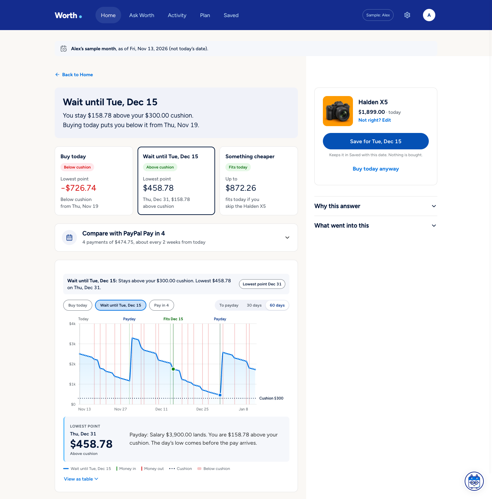
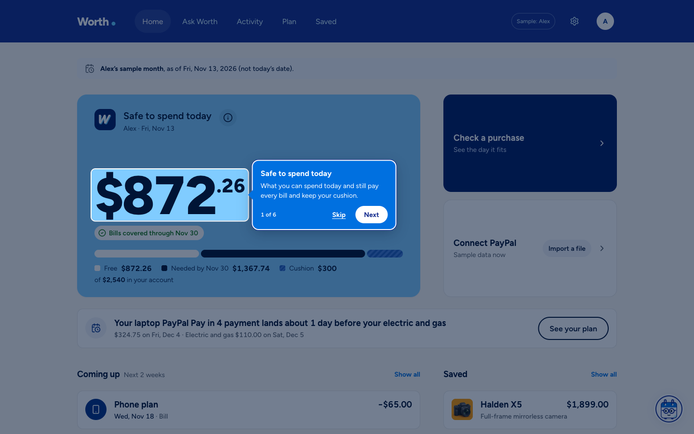

# Worth

Buy now, wait, or split it into 4? See which bill each payment lands on before you decide.

Worth is a personal finance agent for shoppers, connected to PayPal: a cash-flow check for the
moment before a purchase. A deterministic engine, written in
integer cents, projects your balance day by day against your bills, paydays and the cushion you
want to keep, and compares buying today, waiting, spending less and PayPal Pay in 4. Claude reads
your question, chooses which of the engine's facts answer it and adds one sentence that the server
checks; every number and date on screen comes from the engine. When you decide to buy, Worth
prepares a PayPal sandbox order that you approve in PayPal and confirm in Worth.

[](https://github.com/iAnmolAgarwal/worth/actions/workflows/ci.yml)
[](LICENSE)
[](https://worth.onrender.com)

**Live:** https://worth.onrender.com, no sign-in needed. Each browser gets its own anonymous
session with a sample plan (Alex, on the demo day Fri, Nov 13, 2026), kept for 24 hours.

**Demo video:** `TODO(owner): demo video link`. **Final commit:** `TODO(owner): final commit hash`.

## Judge quick facts

- **Hosted app:** https://worth.onrender.com opens on Alex's sample plan on the demo day,
  Fri, Nov 13, 2026: the same person and numbers as the video; nothing to install. He has
  $2,540 available, but the $1,899 Halden X5 camera does not fit that day (Safe to spend today
  is $872.26); Worth says wait until Tue, Dec 15, the day after a PayPal invoice pays him.
  https://worth.onrender.com/?replay=demo-dec15 opens his return visit, with the camera saved
  and ready.
- **PayPal sandbox buyer** for checkout and Connect PayPal:
  `TODO(owner): sandbox buyer login — see the Devpost testing notes`.
- **Who's who:** Worth is the shopper's agent. It reads your PayPal activity and your plan, tells
  you the day a purchase fits, and when that day comes you pay with PayPal. It sells nothing.
  Worth's own checkout pays a neutral sandbox merchant ("Sandbox demo merchant",
  `PAYPAL_BRAND_NAME`), which PayPal's approval page names as the payee, never Worth. In a real
  deployment the payment would go to the actual shop.
- **What PayPal does:** Orders v2 create and capture, the official JS SDK v6 PayPal button and
  popup, PayPal Messages for Pay in 4, a server-side Pay Later eligibility check, and verified
  webhooks that turn a refund into a review item. Sandbox only.
- **What AI does:** Claude Sonnet 5.5 interprets the question, picks up to three engine facts
  and writes one placeholder-only sentence the server checks. On the balance chart it picks which
  of the engine's facts answer the question and what the chart shows; the server writes every
  sentence. When you ask to buy, it links to Worth's own comparison, where you press the buttons.
  It never pays or prepares an order.
- **Two minutes:** the path in [Try it](#try-it).




## The problem

A balance says what is in the account, not what is already spoken for. Rent, a car payment and
the last Pay in 4 plan are all still coming, and the question at checkout is not "do I have
$1,899?" but "what does $1,899 today do to the rest of my month?". Alex has $2,540, but only
$872.26 of it is safe to spend on Fri, Nov 13; the $1,899 Halden X5 fits on Tue, Dec 15. Pay in 4 makes the question
harder: the same total arrives as four payments, and one of them may land the day after rent.

Worth answers that question for one purchase at a time, with the dates. The US numbers say it is
worth answering: only 63% of adults would cover a $400 emergency expense with cash or its
equivalent (Federal Reserve, [SHED 2025](https://www.federalreserve.gov/publications/2026-economic-well-being-of-us-households-in-2025-executive-summary.htm)),
about 63% of BNPL borrowers had loans open at the same time in 2022
([CFPB, January 2025](https://files.consumerfinance.gov/f/documents/cfpb_BNPL_Report_2025_01.pdf)),
and 47% of BNPL users say they paid late in the past year
([LendingTree, 2026](https://www.lendingtree.com/personal/buy-now-pay-later-loan-statistics/)).

## What it does

- **Home: safe to spend today.** One card shows the most you could spend today and still pay every
  bill and keep your cushion ($872.26 for Alex), with a bar that splits the balance into Free,
  Needed by <the low day> and Cushion. Beside it are two rows: **Check a purchase** and
  **Connect PayPal** (with **Import a file** for a CSV). Below: a warning when a running Pay in 4
  payment lands next to a bill, then Coming up and Saved side by side. If even the cushion is not
  covered, the card says "Short by …" instead.
- **Ask Worth.** Ask in your own words ("Can I afford the $1,899 Halden X5?", "What's coming up?",
  "If I put it on Pay in 4, which bills would the payments land next to?"). The answer shows how
  Worth read the question, the engine's verdict, Claude's checked note, the facts Claude picked
  and, under **How Ask Worth read this**, the tool that ran, why each fact was picked and every
  server check that passed.
- **Buy today, wait, or spend less.** The purchase answer page compares the three: the lowest
  projected balance for each, the earliest day that keeps the cushion (a 35-day search), the most
  you could spend today, and the low point if everyday spending runs 20% higher (under **What went into
  this**).
- **Pay in 4, payment by payment.** PayPal Pay in 4 is shown as four dated payments, each placed
  against the nearest bill or other instalment within three days, with any plans already
  running and PayPal's own Pay in 4 message beside it. It is a comparison, never a
  recommendation: Worth's sentence checks reject wording that suggests Pay in 4 makes something
  fit.
- **A balance chart you can read.** On the purchase answer page, the pills above the chart are
  the options (Buy today, Wait until <date>, Pay in 4). Worth's recommendation is pressed when the
  page opens; press others to compare them, or unpress all of them to see the "No purchase" line.
  Each pressed option gets one summary box. The cushion is a dotted line, any stretch below it is
  shaded red, thin green lines mark days money comes in and thin red lines days money goes out.
  A range control switches between To payday, 30 days and 60 days, a day-in-focus panel explains
  the day you point at (or pin with the arrow keys), and **View as table** lists each day's
  lowest balance.
- **The guide explains the chart.** Ask Worth on that page about the chart ("What does the red
  shading mean if I buy it today?") and the guide answers from the chart's own facts and changes
  the view to match: which pills are pressed, the range and the day in focus. A short nudge per
  screen points to it.
- **A first-visit tour.** Six steps over Home (safe to spend, the bar, Check a purchase, the
  guide, Saved, Connect PayPal) on a first visit. **Take the tour** in the Ask Worth panel replays
  it; `?tour=1` forces it and `?tour=0` suppresses it.
- **Checkout prepared, never taken.** "Buy today anyway" or "Buy with PayPal" on the comparison
  prepares a PayPal sandbox order behind server guards. "Go ahead and buy the studio headphones"
  in Ask Worth shows the verdict and a link to that comparison; it never buys. You approve in
  PayPal; Worth captures only when you confirm in Worth, and the payment shows up in Activity
  once.
- **Save it for the day it fits.** "Save for Tue, Dec 15" keeps the item with its date. When the
  day comes, Saved runs a fresh check against today's funds (asking you to confirm them first if
  they aren't confirmed for today) and shows "Fresh check: this fits today"; only then does
  **Buy with PayPal** open.
- **Something cheaper, from real stores.** Under Spend less, and when you ask for something
  cheaper, Worth lists up to four similar products from other stores priced within what keeps the
  cushion today, found through Channel3. They link out; Worth does not sell them.
- **Your own PayPal activity.** **Connect PayPal** reads your sandbox account's activity through
  PayPal's MCP server (see [Try it](#connect-your-paypal-sandbox-account)), or **Import a file**
  takes a PayPal activity CSV (personal or business export, up to 1 MB and 10,000 rows; a
  fictional sample export in `src/sample/` runs through the same import). Worth proposes
  recurring bills, categories and existing Pay in 4 plans for you to confirm in one review
  screen, each row tagged From PayPal or You added; it never deducts history from today's funds a
  second time. Afterwards Home reads "PayPal connected · updated today" (or the file's import
  date). Raw CSV files aren't saved.
- **Connect an agent.** Any MCP client can ask Worth before it pays. See [Worth guardrail MCP](#worth-guardrail-mcp).




## Try it

Open https://worth.onrender.com. No sign-in; each browser gets its own anonymous session.

### Two minutes on Alex's sample

1. **Home.** Alex's month on Fri, Nov 13, 2026: $872.26 safe to spend today, of $2,540 in his
   account. (A first visit starts a six-step tour; **Skip** ends it.)
2. **Check a purchase.** Choose **Check a purchase** and ask "Can I afford the $1,899 Halden
   X5?", then **See the comparison**; or open the Halden X5 under Saved. The answer is **Wait
   until Tue, Dec 15**: buying today goes below the $300 cushion from Thu, Nov 19.
3. **The chart.** Press **Buy today** to add it beside the recommended Wait line, and **Pay in 4**
   for the comparison. Ask Worth "What does the red shading on the chart mean?" and it changes the
   chart to show you.
4. **Save for Tue, Dec 15.** The camera waits in Saved with its date.
5. **The return visit.** Open https://worth.onrender.com/?replay=demo-dec15. It is Tue, Dec 15:
   Saved says "Fresh check: this fits today" (lowest $458.78 on Thu, Dec 31).
6. **Buy with PayPal.** Worth checks again and opens PayPal's sandbox checkout. PayPal's page
   names the payee "Sandbox demo merchant", never Worth. Log in with the sandbox buyer
   (`TODO(owner): sandbox buyer login — see the Devpost testing notes`), approve, then confirm in
   Worth.


### Connect your PayPal sandbox account

1. Open the site. You start on Alex's month, which is sample data.
2. On Home, choose **Connect PayPal**, read the note, then **Continue to PayPal**.
3. Log in with the sandbox buyer
   (`TODO(owner): sandbox buyer login — see the Devpost testing notes`). PayPal's screen names
   "Default Application" (PayPal's MCP connector) and asks for transaction data. It also lists
   other permissions (such as invoicing, checkout and disputes), because the connector asks for
   them; Worth only ever calls `list_transactions` and refuses every other tool before any request
   is made (`ALLOWED_TOOLS` in `server/paypalConnect.ts`). Choose **Agree and Connect**. If you
   cancel at PayPal, use your browser's Back button to return.
4. Wait about 30–40 seconds while Worth reads the activity with PayPal's read-only
   `list_transactions` tool. Then check what it found: this account's $1,299 Laptop bought with
   Pay in 4 appears as a plan. A purchase funded by PayPal Pay Later with no payment rows starts
   as "1 of 4 paid", with three payments left about 14, 28 and 42 days after the purchase
   (PayPal's US Pay Later takes the first payment at the time of the transaction). **Cancel** or
   **Back** on this screen returns to Home.
5. Enter money available, a cushion and everyday spending (add a payday too, if you can), then
   **Continue**. Home shows "PayPal connected · updated today".
6. To return to Alex: **Settings → Delete my data now → Delete and start over**.

A sandbox account holds only what was done in that sandbox, so it has no payday or bills, and
Worth does not invent any. Until money available and a payday are added (in the review, or later
under Plan), Home can read "$0 · Short by … on <date>": with no income, everyday spending and the
remaining Pay in 4 payments draw the projected balance below your cushion, and the figure is how
far below. Worth keeps
PayPal's access for one read only, and cannot pay, invoice or move money with it.


Pay in 4 itself is chosen inside PayPal's checkout. A sandbox buyer can pick it there; Worth
cannot see which funding the buyer chose (PayPal's order and capture do not say), so after a
purchase Home asks "Did you pay in full or with Pay in 4?" and counts the full price until you
confirm the schedule.

## How PayPal is used

All calls go to the PayPal **sandbox** (`api-m.sandbox.paypal.com`); the server holds the
credentials and the browser receives only the public client ID.

- **Orders v2.** `POST /v2/checkout/orders` with `intent: CAPTURE`, one item at the catalog
  price, and the purchase ID as `reference_id`, `custom_id` and `invoice_id`;
  `experience_context` sets the brand name to a neutral sandbox merchant (`PAYPAL_BRAND_NAME`,
  default "Sandbox demo merchant"; the payee, not Worth), `NO_SHIPPING` and Worth's return and
  cancel URLs.
  `GET` reconciles state and `POST …/capture` captures after the buyer approves and the user
  confirms. `PayPal-Request-Id` is derived from the purchase ID, so retries are idempotent, and
  every returned order is checked for the purchase reference, merchant, currency, amount and
  capture count before it is trusted.
- **JS SDK v6.** The `paypal-payments` component renders PayPal's own `<paypal-button>` and opens
  a one-time payment session (`commit: false`) from the click handler, with the server's order
  promise. Approval only updates the UI; capture is a separate step. If the SDK fails to load,
  the server's approval link is used instead.
- **PayPal Messages.** The `paypal-messages` component renders `<paypal-message>` pinned to the
  short-term Pay in 4 offer next to Worth's comparison. On the hosted US sandbox merchant it reads
  "Pay in 4 interest-free payments of $474.75" for the $1,899 Halden X5.
- **Pay Later eligibility.** The server calls `POST /v2/payments/find-eligible-methods` (US buyer,
  USD amount) and caches the answer per price band; Worth's own $10–$2,000 range check applies on
  top. The browser's `findEligibleMethods` decides only whether to show the button and message.
- **Webhooks.** `/api/paypal/webhook` keeps the raw body and verifies it with
  `/v1/notifications/verify-webhook-signature` before anything else, only for PayPal certificate
  hosts. Order events reconcile the purchase through the same path as capture. A
  `PAYMENT.CAPTURE.REFUNDED` or `REVERSED` event is re-read from PayPal and becomes a review item
  ("The merchant refunded $50…") without changing spending room. Event IDs are deduplicated.
- **Declines.** An `INSTRUMENT_DECLINED` or `PAYER_ACTION_REQUIRED` capture sends the buyer back
  to PayPal to choose another way to pay, keeping the same order. The sandbox decline demo
  (`PayPal-Mock-Response`) is off in production unless `PAYPAL_NEGATIVE_TESTING=true`.
- **Connect PayPal (PayPal's MCP server).** No public API gives third-party apps a consumer's
  PayPal activity; Worth reads it through PayPal's MCP server after you log in (sandbox), or from
  a CSV export. "Connect PayPal" runs OAuth 2.1 (authorization code with PKCE S256, a single-use
  `state` bound to the Worth session) against `https://mcp.sandbox.paypal.com`, with a client
  Worth registers there itself. PayPal's consent screen names "Default Application" (PayPal's
  connector) and asks for transaction data; Worth says so before redirecting. The server then
  calls one MCP tool, `list_transactions`, over six 31-day windows (about 186 days) side by side,
  turns the rows into the same CSV text a personal export holds, and the browser reviews it in the
  usual import step. Event codes become export types: `T1600` (buyer-credit funding) becomes a Pay
  Later funding row, so the existing Pay in 4 detection finds the plan. The rows carry no merchant
  name, so the order description names each one. The access token stays in server memory until one
  read, or at most 10 minutes after the login, and is never sent to the browser. The same token could create and
  send invoices, so the server allow-lists `list_transactions` and refuses every other tool.
  Opening a session takes PayPal about 12 s and each window about 11 s (the six run side by side);
  from Continue to the review screen it took about 35–40 s in our checks. If a session doesn't
  open in 25 s, Connect is hidden for that visitor's visit (and for everyone for a minute after
  two such timeouts in a row), and the CSV path remains. `PAYPAL_CONNECT=off` turns it off.
  When the review is committed, the server itself records where the data came from
  (`importedFrom`: `paypal` only when the CSV is the exact text it built from that login, else
  `file`) and when (`importedAt`); Home's "PayPal connected · updated today" reads those two
  fields, never anything the browser claims.

Checked by hand in the sandbox in October, before the Alex sample: SDK v6 popup approval followed
by exactly one capture, and a US sandbox buyer paying $1,199 (an earlier catalog item) with Pay
in 4 inside PayPal's checkout (4 × $299.75). The webhook path (signature verification, refund to
review item) is covered by the test suite.

## How AI is used

Claude is the interface and the narrator; the engine is the decision-maker.

- **The guide.** Ask Worth is fronted by a small drawn character, also called Worth
  (`src/Guide.tsx`), in a launcher on every screen (`src/AgentLauncher.tsx`). Its expression
  follows the answer (thinking, fits, warning); the panel offers starter questions about the item
  on screen and a **Take the tour** link.
- **Model.** `claude-sonnet-5-5` through `@anthropic-ai/sdk`, with a frozen, prompt-cached system
  prompt and strict tool schemas. The loop allows four model rounds and six tool calls, with no
  SDK retries.
- **Read the question.** `interpret_purchase` reports the item, the price the user wrote, its
  currency, quantity, the user's own timing words and the date they resolve to. The server checks
  each against the user's words: an amount that is not in the message, a non-USD price or a date
  outside the next 35 days stops the answer with a question instead. Catalog prices are read only
  when the message names a catalog item as a whole phrase.
- **Choose what to show.** Every tool (`interpret_purchase`, `list_commitments`,
  `spending_summary`, `get_plan_summary`, `find_alternatives`) also asks Claude for up to three
  engine facts with a reason each, an optional lead-in from a fixed set, and follow-up chips. The
  app writes each fact from the engine's numbers.
- **One checked sentence.** After the tool result Claude may write one sentence of at most 30
  words that names figures, dates and bills only through placeholders such as `{cause_bill}`.
  `checkSentence` rejects free numbers or dates, advice, a value in the wrong place, wording that
  rates Pay in 4, and anything that contradicts the engine's outcome; on any failure the
  engine's template sentence is shown instead. The verdict sentence itself is always a template.
- **Explain and steer the chart.** On the purchase answer page the browser sends what the chart
  shows (the item, the pressed options, the range, the day in focus). For a question about the
  chart, the server rebuilds the comparison with the engine and offers Claude one tool,
  `show_on_chart`, only when such a view is on screen. Claude picks one to three fact IDs and the
  view to show; the server checks every field and writes each sentence from the engine in the
  chart's own words (`server/chartGuide.ts`). The browser applies the view through
  `src/chartControl.ts`: pills, range and day in focus only, never buy, save or navigate. Without
  Claude, built-in rules pick the facts and the view. Each screen has its own one-line nudge
  ("Want me to walk you through this chart?" on the chart).
- **Link to the comparison, never buy.** When you ask to buy a listed item,
  `open_purchase_check` shows Worth's check of buying it today and a link to Worth's own
  comparison for it, built by the server from the catalog. Worth prepares no order: on the
  comparison you choose Buy today anyway, Save for the day it fits, or nothing, and Worth's
  PayPal sandbox checkout opens only behind its guards.
- **What Claude is not allowed to do.** It has no tool that pays, captures, creates an order,
  saves, edits the plan or moves money (the tool list is in `server/chat.ts`; the chart tool in
  `server/chartGuide.ts` changes the view only). It never writes a number or date the user sees:
  verdicts, facts and chart sentences come from the engine through `server/narration.ts` and
  `server/chartGuide.ts`, and its one free sentence passes `checkSentence` or is replaced. It
  never recommends Pay in 4. Its reading of an amount or a date is checked against the user's own
  words (`server/interpret.ts`), and page or item text it receives is quoted as data, not
  instructions.
- **Consent and limits.** The untouched sample plan can use Claude without opt-in; an edited or
  imported plan needs the AI-sharing switch. Requests are capped per IP per hour and per server
  per day; past a cap, or without a key, answers are labelled local calculations.
- **Categories.** A separate bounded request suggests categories for up to 30 imported merchant
  labels, without amounts, dates or IDs. Nothing is applied until the user does it.

The [evaluation](#evaluation) runs these paths live against the real model.

## Tools used

| Tool | How Worth uses it |
| --- | --- |
| PayPal Orders v2 | Create, get and capture sandbox orders bound to the purchase ID; idempotent request IDs; returned orders validated before use |
| PayPal JS SDK v6 (`paypal-payments`) | The official PayPal button and one-time payment popup; approval is shown, capture stays a separate confirmation |
| PayPal Messages (`paypal-messages`) | PayPal's own Pay in 4 message next to Worth's instalment comparison |
| PayPal `find-eligible-methods` | Server-side Pay Later eligibility for the price before the Pay in 4 comparison is offered |
| PayPal Webhooks | Raw-body signature verification; order events reconcile, refunds and reversals become review items |
| PayPal MCP server (`mcp.sandbox.paypal.com`) | Connect PayPal: OAuth with PKCE, then only its `list_transactions` tool reads the logged-in user's own activity for the import review |
| PayPal sandbox accounts and negative testing | A US sandbox merchant and buyer; `PayPal-Mock-Response` for the decline and re-approve path |
| Claude Sonnet 5.5 (Anthropic API) | Interprets questions, picks engine facts, writes one checked sentence, picks chart facts and the chart view (`show_on_chart`), may link to Worth's comparison for an item, suggests import categories |
| Claude Opus 5.5 (Anthropic API) | Offline only: the independent judge in the live AI eval (`eval/judge.ts`); never called by the app |
| Channel3 API | `search`, `similar` and product reads for "similar items that fit today"; 6 h cache, daily and per-IP caps, recorded results as fallback |
| Model Context Protocol SDK | Worth guardrail MCP: the `/mcp` server and stdio relay that let outside agents check affordability at any store before they buy |
| Render | Hosts the app from `render.yaml`: one Node 24 web service with a 1 GB persistent disk |
| SQLite (`node:sqlite`) | Session-scoped storage on that disk: plans, purchases, saved items, webhook events, agent tokens |
| React 19, Vite, Express 5, Zod 4, TypeScript | The client, build, HTTP server and validation at every boundary |
| Unsplash | Six of the seven product photos, each checked for brand marks; the Halden X5 image is generated ([credits](docs/DESIGN-SOURCES.md)) |
| Figtree, Lucide | The typeface (OFL 1.1) and icons (ISC) |
| Vitest, oxlint, Prettier, GitHub Actions | Tests, lint, formatting and CI (`npm run check` on every push and pull request) |

## How it is built

```
  browser (React 19, Vite) ───────── PayPal JS SDK v6: button · popup · <paypal-message>
        │  JSON + X-Worth-Client                                │ buyer approves
        ▼                                                       ▼
  Express 5 (server/app.ts) ──── Orders v2 · find-eligible-methods · verify-webhook-signature
   session cookie · Zod · rate limits ◄──── POST /api/paypal/webhook (raw body) ◄── PayPal
        │                    │                         │
        │                    ▼                         └── Channel3 (similar items, cached)
        │        server/chat.ts (Anthropic SDK)
        │        tools ─► interpret · commitments · spending · plan · alternatives
        │        open_purchase_check ─► #decision?product=<id> (no order)
        │        show_on_chart ─► chart view only (pills · range · day), facts by ID
        │        sentence ─► checkSentence ─► template on any failure
        ▼                    │
  shared/finance.ts (pure TypeScript, integer cents) ◄──┘   the model's tools ARE the engine
  forecast · assessPurchase · compareOptions · payIn4Schedule · collisions
        │
  node:sqlite on the Render disk (one row set per anonymous session)

  /mcp (bearer token, no Claude) ─► the same engine; a link to Worth, never an order
```

- **The engine** (`shared/finance.ts`, `shared/collision.ts`) is pure: data in, data out. It
  starts from today's confirmed funds, adds dated income, subtracts bills, subscriptions,
  everyday spending, running instalments and reserved purchases, and keeps the intraday low.
  Bills come before income on the same day. Waiting is searched over the next 35 days, and each
  candidate is judged over the same window, today through today + 60.
- **The server** (`server/`) owns the catalog, the session, every guard and every PayPal call.
  A checkout is reserved in SQLite before the remote call, at most one is active per session,
  and a per-purchase lock serialises capture, webhook and cancel.
- **The AI layer** (`server/chat.ts`, `server/narration.ts`, `server/interpret.ts`) turns a
  message into one engine call and composes the answer from engine sentences.
- **The client** (`src/`) renders the answer, the trace, the comparison and the chart, and
  mounts PayPal's components unmodified.

[docs/ARCHITECTURE.md](docs/ARCHITECTURE.md) has the full design: the forecast, the AI
boundary, the payment state machine, Channel3, saved plans, sessions and privacy.

## Worth guardrail MCP

Shopping agents are starting to buy for people. Worth's guardrail MCP is the check such an agent
calls before it pays: it answers from the person's own plan whether the purchase fits, and when,
and it has no tool that pays or creates an order. Worth runs it as its own Model Context Protocol
server at `/mcp` (Streamable HTTP, stateless) with a stdio relay for local clients. Create a revocable agent token in **Settings → Connect an agent**, paste
the generated config into Claude Desktop or any MCP client, and ask "Can I afford the $1,899
Halden X5?" in your own assistant.

- `check_affordability` is the guardrail for any store. It returns Worth's decision (affordable
  now, later, or not; the safe amount; the earliest date; the low point and the bill behind it;
  Pay in 4 as a comparison) with a ready-to-quote summary from Worth's templates. Coherence
  invariants are checked before every answer.
- `purchase_check_link` returns, for one of Worth's listed items, a link to Worth's own
  comparison with the same verdict. Worth creates no order; the person decides there and presses
  the buttons themselves.
- `list_saved_plans` lists saved items and wait plans.

The MCP path makes no Anthropic call. Tokens are stored as SHA-256 fingerprints, bound to one
plan and rate-limited. Setup, the tool contract and the security model are in
[docs/MCP.md](docs/MCP.md).


## Limits and degradation

- **Sandbox only.** No real money moves and no goods ship. Worth's checkout covers seven listed
  sample items; `open_purchase_check` and `purchase_check_link` link only to those.
- **USD only.** No public API gives third-party apps a consumer's PayPal activity; Worth reads it
  through PayPal's MCP server after you log in (sandbox), or from a CSV export. A sandbox account
  holds only what was done in the sandbox (rows can't be backdated), so its history is short.
  Foreign-currency rows without a USD conversion block positive answers until resolved.
- **Connect PayPal depends on PayPal's hosted MCP server**, which names "Default Application" on
  its consent screen, and has had outages. When it is slow or down, the CSV export still works.
- **Pay in 4 is illustrative.** Worth's schedule uses 14-day gaps; the sandbox's real schedule for
  the camera used 16. PayPal sets the terms at checkout, and the order does not say whether Pay
  in 4 was used, so the user confirms it afterwards.
- **The sample day is pinned.** Alex's sample plan is fixed to Fri, Nov 13, 2026 (and Tue,
  Dec 15 for the return visit), the days its story is tuned for, so it reads the same whenever
  it is opened. Imported data always uses your real today.
- **Without Claude** (no key, a provider error, the hourly or daily cap, or AI sharing off),
  answers are labelled local calculations; every engine feature keeps working.
- **Without PayPal credentials**, checkout runs in a labelled simulated mode. If the SDK cannot
  load, the server's approval link is used. PayPal Messages are optional.
- **Without Channel3** the similar-items panel is hidden; when Channel3 fails or its daily cap is
  reached, recorded example results are shown, labelled as examples.
- **One instance.** SQLite on a single Render disk; sessions expire after 24 hours unless the
  user opts in to 30 days. There is no account and no recovery if the cookie is lost.

## Stack

Node.js 24 · TypeScript · React 19 · Vite · Express 5 · Zod 4 · `node:sqlite` · Anthropic API ·
PayPal REST and JS SDK v6 · Channel3 · MCP SDK · Vitest · oxlint · Prettier

## Setup

Prerequisites: Node.js 24 and npm. SQLite is built into Node; there is no database to run.
Keys are optional (see "Without keys" below).

1. `git clone https://github.com/iAnmolAgarwal/worth.git && cd worth`
2. `npm ci`
3. `cp .env.example .env` and fill in what you have (table below).
4. `npm run dev` and open http://localhost:5173. The dev server serves the API and the client
   from one Express process.
5. `npm run check` runs lint, TypeScript, the test suite and the production build. It needs no
   keys and no network.

**Without keys** the whole engine works: Ask Worth answers with labelled local calculations,
checkout is a labelled simulation, and the similar-items panel is hidden. Add
`ANTHROPIC_API_KEY` for Claude, the PayPal sandbox trio for real sandbox checkout, and
`CHANNEL3_API_KEY` for similar items.

**PayPal sandbox:** in the [developer dashboard](https://developer.paypal.com/dashboard/) create
a sandbox REST app on a US business account, copy its client ID and secret, and approve with a
separate sandbox personal account. Webhooks need a public HTTPS URL; register
`https://<host>/api/paypal/webhook` for `CHECKOUT.ORDER.*`, `PAYMENT.CAPTURE.*` events and put
the webhook ID in `PAYPAL_WEBHOOK_ID`. Localhost alone cannot receive them.

## Environment variables

| Name | Purpose |
| --- | --- |
| `ANTHROPIC_API_KEY` | Anthropic key for Ask Worth and category suggestions. Optional |
| `ANTHROPIC_MODEL` | Model ID; default `claude-sonnet-5-5` |
| `PAYPAL_CLIENT_ID`, `PAYPAL_CLIENT_SECRET` | PayPal **sandbox** REST app credentials. Without them checkout is simulated |
| `PAYPAL_WEBHOOK_ID` | ID of the registered sandbox webhook; required to accept webhook deliveries |
| `PAYPAL_CONNECT` | `on` or `off`. Connect PayPal through PayPal's MCP server; on by default when `PAYPAL_CLIENT_ID` is set |
| `PAYPAL_MCP_CLIENT_ID` | Optional: a client already registered on PayPal's MCP server for `<APP_ORIGIN>/api/paypal/connect/callback`. Without it Worth registers one at first use |
| `PAYPAL_BRAND_NAME` | The payee PayPal's approval page and Activity show for Worth's own sandbox checkout; default `Sandbox demo merchant` |
| `PAYPAL_NEGATIVE_TESTING` | Allows the sandbox decline demo. On in development unless `false`; off in production unless `true` |
| `CHANNEL3_API_KEY` | Channel3 key for similar items. Without it the panel is hidden |
| `CHANNEL3_MODE` | `live` (default with a key), `fixture` (recorded results, no credits) or `off` |
| `CHANNEL3_DAILY_LIMIT`, `CHANNEL3_IP_HOURLY_LIMIT` | Live Channel3 searches per day (300) and per client IP per hour (20) |
| `CLAUDE_DAILY_LIMIT`, `CLAUDE_IP_HOURLY_LIMIT` | Claude requests per server per day (200) and per client IP per hour (20) |
| `SESSION_IP_HOURLY_LIMIT` | New sessions per client IP per hour (30) |
| `MAX_SESSIONS`, `MAX_TRANSACTIONS` | Live sessions (5,000) and stored transactions per session (20,000) |
| `MCP_IP_PER_MINUTE`, `MCP_TOKEN_PER_MINUTE` | `/mcp` requests per IP per minute (120) and per token per minute (30) |
| `PORT`, `HOST` | Port (5173) and bind address (`0.0.0.0` in production, `127.0.0.1` otherwise) |
| `APP_ORIGIN` | Public browser origin. Falls back to `APP_URL`, then `RENDER_EXTERNAL_URL`, then `http://localhost:$PORT`. Production refuses localhost or plain HTTP |
| `TRUST_PROXY` | Reverse-proxy hops trusted for the client IP. Required in production (2 on Render) |
| `HANDOFF_SECRET` | Key shared with the example store for signed hand-offs to `/check`: 32+ random bytes, base64url. Set it with `MERCHANT_ORIGIN`, or neither: with neither the hand-off is off (`handoff: off` in `/api/health`), and production refuses only one without the other |
| `MERCHANT_ORIGIN` | The example store's origin, the only place a hand-off may return to. HTTPS only in production |
| `HANDOFF_MERCHANT_ID` | The store's `mid` claim; default `larkspur` |
| `DATABASE_PATH` | SQLite file; default `.data/worth.sqlite` |
| `SAMPLE_PERSONA` | Who a new session starts as: `alex` (default) on the pinned demo day, or `maya`, the test fixture dated today. The test setups set `maya` |
| `MAX_HEAP_MB` | Node heap for `npm start` (384); set in the host environment, not `.env` |
| `NODE_ENV` | `production` turns on the CSP, HSTS, the `__Host-` secure cookie and the public HTTPS origin requirement |

Keys stay on the server and in the gitignored `.env`; none is a `VITE_` variable and none is ever
committed. The MCP stdio relay reads `WORTH_MCP_URL` and `WORTH_MCP_TOKEN` from the MCP client's
config, not from `.env`.

## Scripts

| Command | Purpose |
| --- | --- |
| `npm run dev` | Express with Vite middleware on `PORT` |
| `npm run build` | TypeScript build and production client bundle in `dist/` |
| `npm start` | Production server (serves `dist/`) |
| `npm run check` | Lint, typecheck, tests and build: what CI runs |
| `npm test` | Vitest suite, one worker |
| `npm run typecheck` / `npm run lint` | TypeScript and oxlint |
| `npm run format` / `npm run format:check` | Prettier |
| `npm run eval:live -- --out <dir> --env <file> [--runs 3] [--judge]` | Live AI eval against the real model; writes the report outside the repo |
| `npm run channel3:record` | Refresh the recorded Channel3 example results |
| `npm run mcp:stdio` | The MCP stdio relay, for running it in a terminal |

## Deploying

Production is one Render web service from [`render.yaml`](render.yaml): Node 24, the Starter
plan, a 1 GB disk at `/var/data` for SQLite, health check `/api/health`, auto-deploy off.

1. Create a Blueprint from the repository. Fill the `sync: false` variables (Anthropic, PayPal,
   Channel3) in the dashboard.
2. Deploy, then check the log line for the `X-Forwarded-For` hop count; `TRUST_PROXY` is 2 on
   Render.
3. Register `https://<host>/api/paypal/webhook` in the PayPal sandbox app and set
   `PAYPAL_WEBHOOK_ID`.
4. `GET /api/health` answers `{ ok, service, channel3 }`.

A disk rules out zero-downtime deploys: each deploy shows about 30 seconds of 502 while the
instance restarts, so deploys stop during judging.

## Evaluation

Two layers, both on the AI path; the engine has its own unit and property tests.

- **In CI:** recorded Claude responses for every probe are replayed through the real server
  pipeline (`tests/ai-eval.test.ts`), so any change to validation, the engine, the fact catalogs
  or the sentence check is graded against real model output on every push.
- **Live:** `npm run eval:live` sends every probe to `claude-sonnet-5-5`, grades each reply in
  code (wrong amount, date, item, currency or outcome; a verdict that disagrees with the engine;
  bill-skipping or credit advice; an alternative that does not fit) and has Claude Opus 5.5 judge
  each answer for contradictions and risky advice.

Measured on 2026-10-04, before the Alex sample and the chart guide (so these runs cover neither
the Halden X5 story nor `show_on_chart`): three consecutive live runs over 63 probes (45 train, 18 held out; 73 replies a
run) had **0 unsafe outcomes** in every run, 0 programmatic contradictions, and Claude's
sentence written and accepted for 85–88% of answers. A follow-up single run over 65 probes had 0
unsafe outcomes and 86% accepted sentences. Exact counts, the judge findings and what was changed
after them are in [docs/EVALUATION.md](docs/EVALUATION.md).

## Data sources and attribution

- **Sample plan and catalog** (`shared/seed.ts`) are synthetic: Alex, his bills, the Halden
  camera brand, the products and the example store are invented. Product names are used to name items, never as logos.
- **Product photos** are from [Unsplash](https://unsplash.com/license), credited per photo in
  [docs/DESIGN-SOURCES.md](docs/DESIGN-SOURCES.md); the Halden X5 photo is AI-generated for this
  project and shows no brand mark.
- **Similar items** are live Channel3 results, linking to the retailer; Worth keeps them only in
  a short cache and in the rows a user saves.
- **PayPal marks** appear only inside PayPal's own SDK components. Worth is an independent
  hackathon project and not a PayPal product.
- **Statistics** in [The problem](#the-problem) are from the Federal Reserve, the CFPB and
  LendingTree, linked where they are cited.

## Example: a shop adding the Worth swipe to its PayPal button

`merchant/` is a separate demo app, not part of Worth: an invented shop, Larkspur Supply, that
adds a Worth swipe (`<worth-check>`) to its PayPal button. It shows how a store could hand a
shopper to Worth before they pay. The swipe opens Worth's `/check` page with a quote the
store's server signed (the contract is described in [docs/ARCHITECTURE.md](docs/ARCHITECTURE.md));
Worth verifies it, names that store on `/check` only, and refuses a tampered or expired link. If the shopper agrees, the store
reports the payment back so it shows once in Activity. The store runs its own PayPal checkout
(Orders v2, JS SDK v6 and webhooks, sandbox), as Worth's own checkout does.

The hosted Worth app does not link to it. To run both locally, start Worth with `npm run dev`
and the store with `npm run dev:merchant`, with `HANDOFF_SECRET` set to the same value on both
and `MERCHANT_ORIGIN` / `WORTH_ORIGIN` pointing at each other (see `.env.example`).

## Security

Sandbox only. See [SECURITY.md](SECURITY.md) for what is protected and how to report an issue.

## License

Code: MIT, see [LICENSE](LICENSE). Product photos, fonts, icons and dependencies keep their own
licences, listed in [docs/DESIGN-SOURCES.md](docs/DESIGN-SOURCES.md).
