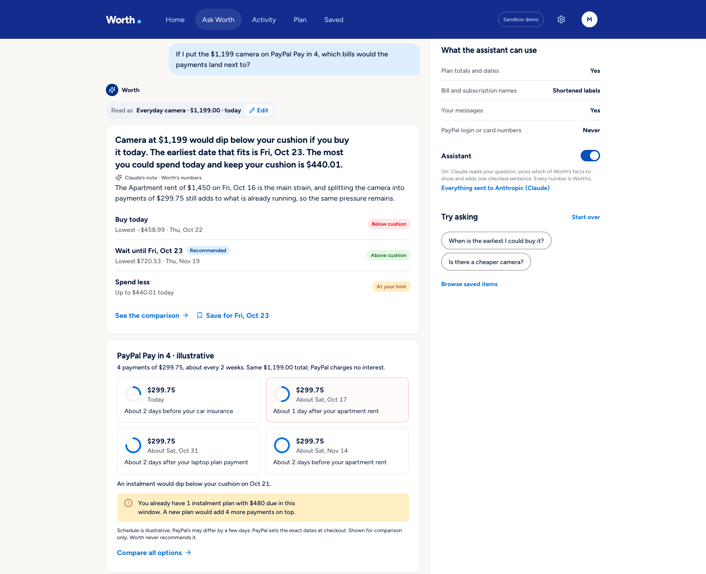
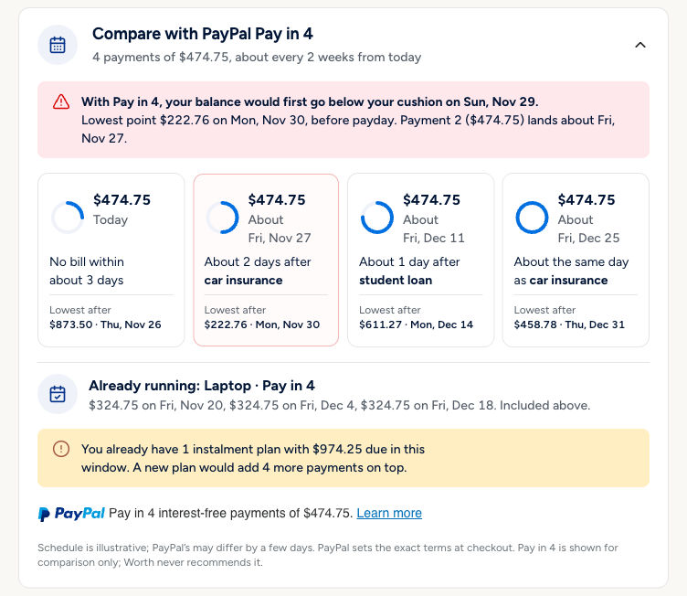
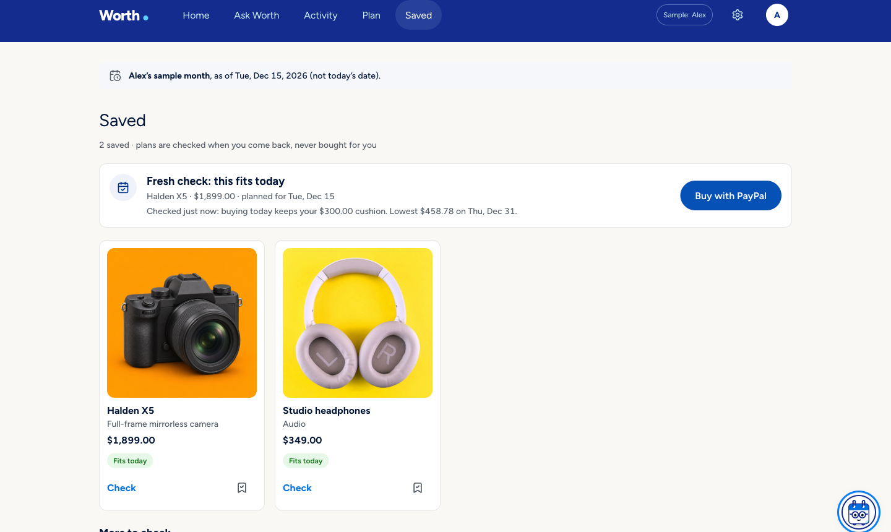
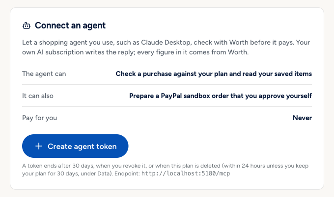

# Worth

Buy now, wait, or split it into 4? See which bill each payment lands on before you decide.

Worth is a cash-flow check for the moment before a purchase. A deterministic engine, written in
integer cents, projects your balance day by day against your bills, paydays and the cushion you
want to keep, and compares buying today, waiting, spending less and PayPal Pay in 4. Claude reads
your question, chooses which of the engine's facts answer it and adds one sentence that the server
checks; every number and date on screen comes from the engine. When you decide to buy, Worth
prepares a PayPal sandbox order that you approve in PayPal and confirm in Worth.

[](https://github.com/iAnmolAgarwal/worth/actions/workflows/ci.yml)
[](LICENSE)
[](https://worth.onrender.com)

**Live:** https://worth.onrender.com, no sign-in needed. Each browser gets its own anonymous
session with a sample plan (Maya), kept for 24 hours.

**Demo video:** <!-- TODO(coordinator): YouTube link --> _link added at submission_.

## Judge quick facts

- **Hosted app:** https://worth.onrender.com opens on Maya's sample plan; nothing to install.
  Want the exact numbers from the video? Open https://worth.onrender.com/?replay=video (sample
  data only; "Back to today" exits). Otherwise dates follow your own today, so they will not
  match the video.
<!-- TODO(coordinator): fill in a dedicated judge sandbox buyer account, never the team's own. -->
- **PayPal sandbox buyer** for the checkout step: email `TODO`, password `TODO`. If these still
  read `TODO`, ask the maintainer.
- **Who's who:** Worth is the shopper's side. It reads your plan and helps you decide when and
  how to pay, and it sells nothing. **Larkspur Supply is a demo store** that stands in for any
  shop that takes PayPal: the sandbox merchant account plays that store, so PayPal's approval
  page names "Larkspur Supply (demo store)" as the payee, never Worth. In a real deployment Worth
  would sit with the shopper (in the PayPal app, or as a check before the PayPal button) and the
  payment would go to the actual shop.
- **What PayPal does:** Orders v2 create and capture, the official JS SDK v6 PayPal button and
  popup, PayPal Messages for Pay in 4, a server-side Pay Later eligibility check, and verified
  webhooks that turn a refund into a review item. Sandbox only.
- **What AI does:** Claude Sonnet 5.5 interprets the question, picks up to three engine facts
  and writes one placeholder-only sentence the server checks; it can ask for a PayPal order,
  which the server prepares only behind the same guards as the Buy button. It never pays.
- **Three clicks:** Home → "Can I afford a $1,199 camera?" → "See the comparison" →
  "Compare with PayPal Pay in 4". Then the checkout path in [Try it](#try-it).





## The problem

A balance says what is in the account, not what is already spoken for. Rent, a car payment and
the last Pay in 4 plan are all still coming, and the question at checkout is not "do I have
$1,199?" but "what does $1,199 today do to the rest of my month?". Pay in 4 makes the question
harder: the same total arrives as four payments, and one of them may land the day after rent.

Worth answers that question for one purchase at a time, with the dates. The US numbers say it is
worth answering: only 63% of adults would cover a $400 emergency expense with cash or its
equivalent (Federal Reserve, [SHED 2025](https://www.federalreserve.gov/publications/2026-economic-well-being-of-us-households-in-2025-executive-summary.htm)),
about 63% of BNPL borrowers had loans open at the same time in 2022
([CFPB, January 2025](https://files.consumerfinance.gov/f/documents/cfpb_BNPL_Report_2025_01.pdf)),
and 47% of BNPL users say they paid late in the past year
([LendingTree, 2026](https://www.lendingtree.com/personal/buy-now-pay-later-loan-statistics/)).

## What it does

- **Home: room to spend today.** The most you could spend today and still keep your cushion
  through the forecast, the next payday, what is coming up, and a warning when a running Pay in 4
  payment lands next to a bill.
- **Ask Worth.** Ask in your own words ("Can I afford a $1,199 camera?", "What's coming up?",
  "If I put it on Pay in 4, which bills would the payments land next to?"). The answer shows how
  Worth read the question, the engine's verdict, Claude's checked note, the facts Claude picked
  and, under **How Ask Worth read this**, the tool that ran, why each fact was picked and every
  server check that passed.
- **Buy today, wait, or spend less.** The Decision view compares the three: the lowest projected
  balance for each, the earliest day that keeps the cushion, the most you could spend today, and
  the low point if everyday spending runs 20% higher.
- **Pay in 4, payment by payment.** PayPal Pay in 4 is shown as four dated payments, each placed
  against the nearest bill or other instalment within three days, with any plans already
  running and PayPal's own Pay in 4 message beside it. It is a comparison, never a
  recommendation: Worth's sentence checks reject wording that suggests Pay in 4 makes something
  fit.
- **A balance chart you can read.** The forecast is drawn as the daily low with the cushion, and
  every payday and bill of $100 or more is a line you can click (or reach with the arrow keys)
  for its amount and the balance after it. A table view carries the same numbers.
- **Checkout prepared, never taken.** "Buy" (or "Go ahead and buy the studio headphones" in Ask
  Worth) prepares a PayPal sandbox order behind server guards. You approve in PayPal; Worth
  captures only when you confirm in Worth, and the payment shows up in Activity once.
- **Save it for the day it fits.** "Save for Fri, Oct 23" keeps the item with its date. When the
  day comes, Saved says the plan suggests it may fit, you confirm today's funds, Worth checks
  again, and only then does Buy with PayPal open.
- **Something cheaper, from real stores.** Under Spend less, and when you ask for something
  cheaper, Worth lists up to four similar products from other stores priced within what keeps the
  cushion today, found through Channel3. They link out; Worth does not sell them.
- **Your own history.** Import a PayPal activity CSV (personal or business export, up to 1 MB and
  10,000 rows). Worth proposes recurring bills, categories and existing Pay in 4 plans for you to
  confirm; it never deducts history from today's funds a second time. Home starts with "Start
  with your PayPal activity": choose the file (or **Try with a sample PayPal export**, a fictional
  export in `src/sample/` that runs through the same import), tick what Worth found in one review
  screen, each row tagged From PayPal or You added, and Home becomes your month from PayPal. Raw
  CSV files aren't saved.
- **Connect an agent.** Any MCP client can ask Worth before it pays. See [Worth guardrail MCP](#worth-guardrail-mcp).




## Try it

On https://worth.onrender.com (no sign-in):

1. On Home, click **Can I afford a $1,199 camera?** Ask Worth answers with the engine's verdict.
   Open **How Ask Worth read this** to see what Claude chose and what the server checked. Then
   ask: "If I put it on Pay in 4, which bills would the payments land next to?"
2. Click **See the comparison**, then **Compare with PayPal Pay in 4**: four payments, the bill
   each one lands near, the plan already running, and PayPal's message.
3. In Ask Worth, type "Go ahead and buy the studio headphones". Worth shows its verdict for the
   $349 headphones and an **Open at Larkspur Supply** link to the store's own product page, where
   you pay with PayPal (the sandbox buyer above). Worth prepares no order: the store sells the
   item and PayPal takes the payment.

Pay in 4 itself is chosen inside PayPal's checkout. A sandbox buyer can pick it there; Worth
cannot see which funding the buyer chose (PayPal's order and capture do not say), so after a
purchase Home asks "Did you pay in full or with Pay in 4?" and counts the full price until you
confirm the schedule.

## How PayPal is used

All calls go to the PayPal **sandbox** (`api-m.sandbox.paypal.com`); the server holds the
credentials and the browser receives only the public client ID.

- **Orders v2.** `POST /v2/checkout/orders` with `intent: CAPTURE`, one item at the catalog
  price, and the purchase ID as `reference_id`, `custom_id` and `invoice_id`;
  `experience_context` sets the brand name to the demo store (the payee, not Worth),
  `NO_SHIPPING` and Worth's return and cancel URLs.
  `GET` reconciles state and `POST …/capture` captures after the buyer approves and the user
  confirms. `PayPal-Request-Id` is derived from the purchase ID, so retries are idempotent, and
  every returned order is checked for the purchase reference, merchant, currency, amount and
  capture count before it is trusted.
- **JS SDK v6.** The `paypal-payments` component renders PayPal's own `<paypal-button>` and opens
  a one-time payment session (`commit: false`) from the click handler, with the server's order
  promise. Approval only updates the UI; capture is a separate step. If the SDK fails to load,
  the server's approval link is used instead.
- **PayPal Messages.** The `paypal-messages` component renders `<paypal-message>` pinned to the
  short-term Pay in 4 offer next to Worth's comparison. On the hosted US sandbox merchant it reads
  "Pay in 4 interest-free payments of $299.75" for the $1,199 camera.
- **Pay Later eligibility.** The server calls `POST /v2/payments/find-eligible-methods` (US buyer,
  USD amount) and caches the answer per price band; Worth's own $10–$2,000 range check applies on
  top. The browser's `findEligibleMethods` decides only whether to show the button and message.
- **Webhooks.** `/api/paypal/webhook` keeps the raw body and verifies it with
  `/v1/notifications/verify-webhook-signature` before anything else, only for PayPal certificate
  hosts. Order events reconcile the purchase through the same path as capture. A
  `PAYMENT.CAPTURE.REFUNDED` or `REVERSED` event is re-read from PayPal and becomes a review item
  ("The merchant refunded $50…") without changing spending room. Event IDs are deduplicated.
- **Declines.** An `INSTRUMENT_DECLINED` or `PAYER_ACTION_REQUIRED` capture sends the buyer back
  to PayPal to choose another way to pay, keeping the same order. The sandbox decline demo
  (`PayPal-Mock-Response`) is off in production unless `PAYPAL_NEGATIVE_TESTING=true`.

Verified against the sandbox: SDK v6 popup approval followed by exactly one capture; a US sandbox
buyer paying $1,199 with Pay in 4 inside PayPal's checkout (4 × $299.75); and, on the hosted
app, a capture followed by a $50 refund whose webhook arrived, passed verification and produced
the review item.

## How AI is used

Claude is the interface and the narrator; the engine is the decision-maker.

- **Model.** `claude-sonnet-5-5` through `@anthropic-ai/sdk`, with a frozen, prompt-cached system
  prompt and strict tool schemas. The loop allows four model rounds and six tool calls, with no
  SDK retries.
- **Read the question.** `interpret_purchase` reports the item, the price the user wrote, its
  currency, quantity, the user's own timing words and the date they resolve to. The server checks
  each against the user's words: an amount that is not in the message, a non-USD price or a date
  outside the next 30 days stops the answer with a question instead. Catalog prices are read only
  when the message names a catalog item as a whole phrase.
- **Choose what to show.** Every tool (`interpret_purchase`, `list_commitments`,
  `spending_summary`, `get_plan_summary`, `find_alternatives`) also asks Claude for up to three
  engine facts with a reason each, an optional lead-in from a fixed set, and follow-up chips. The
  app writes each fact from the engine's numbers.
- **One checked sentence.** After the tool result Claude may write one sentence of at most 30
  words that names figures, dates and bills only through placeholders such as `{cause_bill}`.
  `checkSentence` rejects free numbers or dates, advice, a value in the wrong place, wording that
  rates Pay in 4, and anything that contradicts the engine's outcome; on any failure the
  engine's template sentence is shown instead. The verdict sentence itself is always a template.
- **Send you to the store, never sell.** When you ask to buy a demo-store item,
  `open_store_checkout` shows Worth's check of buying it today and an "Open at Larkspur Supply"
  link to the store's own product page, built by the server from `MERCHANT_ORIGIN` and the
  catalog. Worth prepares no order: you pay on the store's page with its own PayPal checkout.
- **Consent and limits.** The untouched sample plan can use Claude without opt-in; an edited or
  imported plan needs the AI-sharing switch. Requests are capped per IP per hour and per server
  per day; past a cap, or without a key, answers are labelled local calculations.
- **Categories.** A separate bounded request suggests categories for up to 30 imported merchant
  labels, without amounts, dates or IDs. Nothing is applied until the user does it.

The [evaluation](#evaluation) runs these paths live against the real model.

## Tools used

| Tool | How Worth uses it |
| --- | --- |
| PayPal Orders v2 | Create, get and capture sandbox orders bound to the purchase ID; idempotent request IDs; returned orders validated before use |
| PayPal JS SDK v6 (`paypal-payments`) | The official PayPal button and one-time payment popup; approval is shown, capture stays a separate confirmation |
| PayPal Messages (`paypal-messages`) | PayPal's own Pay in 4 message next to Worth's instalment comparison |
| PayPal `find-eligible-methods` | Server-side Pay Later eligibility for the price before the Pay in 4 comparison is offered |
| PayPal Webhooks | Raw-body signature verification; order events reconcile, refunds and reversals become review items |
| PayPal sandbox accounts and negative testing | A US sandbox merchant and buyer; `PayPal-Mock-Response` for the decline and re-approve path |
| Claude Sonnet 5.5 (Anthropic API) | Interprets questions, picks engine facts, writes one checked sentence, may link to the demo store's product page, suggests import categories |
| Claude Opus 5.5 (Anthropic API) | Offline only: the independent judge in the live AI eval (`eval/judge.ts`); never called by the app |
| Channel3 API | `search`, `similar` and product reads for "similar items that fit today"; 6 h cache, daily and per-IP caps, recorded results as fallback |
| Model Context Protocol SDK | Worth guardrail MCP: the `/mcp` server and stdio relay that let outside agents check affordability at any store before they buy |
| Render | Hosts the app from `render.yaml`: one Node 24 web service with a 1 GB persistent disk |
| SQLite (`node:sqlite`) | Session-scoped storage on that disk: plans, purchases, saved items, webhook events, agent tokens |
| React 19, Vite, Express 5, Zod 4, TypeScript | The client, build, HTTP server and validation at every boundary |
| Unsplash | The six product photos in the demo store, each checked for brand marks ([credits](docs/DESIGN-SOURCES.md)) |
| Figtree, Lucide | The typeface (OFL 1.1) and icons (ISC) |
| Vitest, oxlint, Prettier, GitHub Actions | Tests, lint, formatting and CI (`npm run check` on every push and pull request) |

## How it is built

```
  browser (React 19, Vite) ───────── PayPal JS SDK v6: button · popup · <paypal-message>
        │  JSON + X-Worth-Client                                │ buyer approves
        ▼                                                       ▼
  Express 5 (server/app.ts) ──── Orders v2 · find-eligible-methods · verify-webhook-signature
   session cookie · Zod · rate limits ◄──── POST /api/paypal/webhook (raw body) ◄── PayPal
        │                    │                         │
        │                    ▼                         └── Channel3 (similar items, cached)
        │        server/chat.ts (Anthropic SDK)
        │        tools ─► interpret · commitments · spending · plan · alternatives
        │        open_store_checkout ─► MERCHANT_ORIGIN/p/<id> (no order)
        │        sentence ─► checkSentence ─► template on any failure
        ▼                    │
  shared/finance.ts (pure TypeScript, integer cents) ◄──┘   the model's tools ARE the engine
  forecast · assessPurchase · compareOptions · payIn4Schedule · collisions
        │
  node:sqlite on the Render disk (one row set per anonymous session)

  /mcp (bearer token, no Claude) ─► the same engine; the store's link, never an order
```

- **The engine** (`shared/finance.ts`, `shared/collision.ts`) is pure: data in, data out. It
  starts from today's confirmed funds, adds dated income, subtracts bills, subscriptions,
  everyday spending, running instalments and reserved purchases, and keeps the intraday low.
  Bills come before income on the same day. Waiting is searched over the next 30 days and each
  candidate is projected 30 days past its purchase.
- **The server** (`server/`) owns the catalog, the session, every guard and every PayPal call.
  A checkout is reserved in SQLite before the remote call, at most one is active per session,
  and a per-purchase lock serialises capture, webhook and cancel.
- **The AI layer** (`server/chat.ts`, `server/narration.ts`, `server/interpret.ts`) turns a
  message into one engine call and composes the answer from engine sentences.
- **The client** (`src/`) renders the answer, the trace, the comparison and the chart, and
  mounts PayPal's components unmodified.

[docs/ARCHITECTURE.md](docs/ARCHITECTURE.md) has the full design: the forecast, the AI
boundary, the payment state machine, Channel3, saved plans, sessions and privacy.

## Worth guardrail MCP

Worth runs its own Model Context Protocol server, Worth guardrail MCP, at `/mcp` (Streamable
HTTP, stateless) with a stdio relay for local clients. Create a revocable agent token in **Settings → Connect an agent**, paste
the generated config into Claude Desktop or any MCP client, and ask "Can I afford the $1,199
camera?" in your own assistant.

- `check_affordability` is the guardrail for any store. It returns Worth's decision (affordable
  now, later, or not; the safe amount; the earliest date; the low point and the bill behind it;
  Pay in 4 as a comparison) with a ready-to-quote summary from Worth's templates. Coherence
  invariants are checked before every answer.
- `store_checkout_link` is the demo store's checkout link: for a Larkspur Supply item it returns
  the store's own product page with the same verdict. Worth creates no order; the person pays on
  the store's page with its PayPal checkout.
- `list_saved_plans` lists saved items and wait plans.

The MCP path makes no Anthropic call. Tokens are stored as SHA-256 fingerprints, bound to one
plan and rate-limited. Setup, the tool contract and the security model are in
[docs/MCP.md](docs/MCP.md).



## Limits and degradation

- **Sandbox only.** No real money moves and no goods ship. The demo store (Larkspur Supply) has
  six items; `open_store_checkout` and `store_checkout_link` link only to those.
- **USD only, CSV only.** There is no consumer API for PayPal activity, so history comes from a
  CSV export or the sample plan. Foreign-currency rows without a USD conversion block positive
  answers until resolved.
- **Pay in 4 is illustrative.** Worth's schedule uses 14-day gaps; the sandbox's real schedule for
  the camera used 16. PayPal sets the terms at checkout, and the order does not say whether Pay
  in 4 was used, so the user confirms it afterwards.
- **Dates follow your today.** The sample plan is dated relative to the viewer's day. The video
  numbers are reproducible at https://worth.onrender.com/?replay=video (sample data only; "Back
  to today" exits).
- **Without Claude** (no key, a provider error, the hourly or daily cap, or AI sharing off),
  answers are labelled local calculations; every engine feature keeps working.
- **Without PayPal credentials**, checkout runs in a labelled simulated mode. If the SDK cannot
  load, the server's approval link is used. PayPal Messages are optional.
- **Without Channel3** the similar-items panel is hidden; when Channel3 fails or its daily cap is
  reached, recorded example results are shown, labelled as examples.
- **One instance.** SQLite on a single Render disk; sessions expire after 24 hours unless the
  user opts in to 30 days. There is no account and no recovery if the cookie is lost.

## Stack

Node.js 24 · TypeScript · React 19 · Vite · Express 5 · Zod 4 · `node:sqlite` · Anthropic API ·
PayPal REST and JS SDK v6 · Channel3 · MCP SDK · Vitest · oxlint · Prettier

## Setup

Prerequisites: Node.js 24 and npm. SQLite is built into Node; there is no database to run.
Keys are optional (see "Without keys" below).

1. `git clone https://github.com/iAnmolAgarwal/worth.git && cd worth`
2. `npm ci`
3. `cp .env.example .env` and fill in what you have (table below).
4. `npm run dev` and open http://localhost:5173. The dev server serves the API and the client
   from one Express process.
5. `npm run check` runs lint, TypeScript, the test suite and the production build. It needs no
   keys and no network.

**Without keys** the whole engine works: Ask Worth answers with labelled local calculations,
checkout is a labelled simulation, and the similar-items panel is hidden. Add
`ANTHROPIC_API_KEY` for Claude, the PayPal sandbox trio for real sandbox checkout, and
`CHANNEL3_API_KEY` for similar items.

**PayPal sandbox:** in the [developer dashboard](https://developer.paypal.com/dashboard/) create
a sandbox REST app on a US business account, copy its client ID and secret, and approve with a
separate sandbox personal account. Webhooks need a public HTTPS URL; register
`https://<host>/api/paypal/webhook` for `CHECKOUT.ORDER.*`, `PAYMENT.CAPTURE.*` events and put
the webhook ID in `PAYPAL_WEBHOOK_ID`. Localhost alone cannot receive them.

## Environment variables

| Name | Purpose |
| --- | --- |
| `ANTHROPIC_API_KEY` | Anthropic key for Ask Worth and category suggestions. Optional |
| `ANTHROPIC_MODEL` | Model ID; default `claude-sonnet-5-5` |
| `PAYPAL_CLIENT_ID`, `PAYPAL_CLIENT_SECRET` | PayPal **sandbox** REST app credentials. Without them checkout is simulated |
| `PAYPAL_WEBHOOK_ID` | ID of the registered sandbox webhook; required to accept webhook deliveries |
| `PAYPAL_NEGATIVE_TESTING` | Allows the sandbox decline demo. On in development unless `false`; off in production unless `true` |
| `CHANNEL3_API_KEY` | Channel3 key for similar items. Without it the panel is hidden |
| `CHANNEL3_MODE` | `live` (default with a key), `fixture` (recorded results, no credits) or `off` |
| `CHANNEL3_DAILY_LIMIT`, `CHANNEL3_IP_HOURLY_LIMIT` | Live Channel3 searches per day (300) and per client IP per hour (20) |
| `CLAUDE_DAILY_LIMIT`, `CLAUDE_IP_HOURLY_LIMIT` | Claude requests per server per day (200) and per client IP per hour (20) |
| `SESSION_IP_HOURLY_LIMIT` | New sessions per client IP per hour (30) |
| `MAX_SESSIONS`, `MAX_TRANSACTIONS` | Live sessions (5,000) and stored transactions per session (20,000) |
| `MCP_IP_PER_MINUTE`, `MCP_TOKEN_PER_MINUTE` | `/mcp` requests per IP per minute (120) and per token per minute (30) |
| `PORT`, `HOST` | Port (5173) and bind address (`0.0.0.0` in production, `127.0.0.1` otherwise) |
| `APP_ORIGIN` | Public browser origin. Falls back to `APP_URL`, then `RENDER_EXTERNAL_URL`, then `http://localhost:$PORT`. Production refuses localhost or plain HTTP |
| `TRUST_PROXY` | Reverse-proxy hops trusted for the client IP. Required in production (2 on Render) |
| `HANDOFF_SECRET` | Key shared with the demo store for signed hand-offs to `/check`: 32+ random bytes, base64url. Set it with `MERCHANT_ORIGIN`, or neither: with neither the hand-off is off (`handoff: off` in `/api/health`), and production refuses only one without the other |
| `MERCHANT_ORIGIN` | The demo store's origin, the only place a hand-off may return to. HTTPS only in production |
| `HANDOFF_MERCHANT_ID` | The store's `mid` claim; default `larkspur` |
| `DATABASE_PATH` | SQLite file; default `.data/worth.sqlite` |
| `MAX_HEAP_MB` | Node heap for `npm start` (384); set in the host environment, not `.env` |
| `NODE_ENV` | `production` turns on the CSP, HSTS, the `__Host-` secure cookie and the public HTTPS origin requirement |

Keys stay on the server and in the gitignored `.env`; none is a `VITE_` variable and none is ever
committed. The MCP stdio relay reads `WORTH_MCP_URL` and `WORTH_MCP_TOKEN` from the MCP client's
config, not from `.env`.

## Scripts

| Command | Purpose |
| --- | --- |
| `npm run dev` | Express with Vite middleware on `PORT` |
| `npm run build` | TypeScript build and production client bundle in `dist/` |
| `npm start` | Production server (serves `dist/`) |
| `npm run check` | Lint, typecheck, tests and build: what CI runs |
| `npm test` | Vitest suite, one worker |
| `npm run typecheck` / `npm run lint` | TypeScript and oxlint |
| `npm run format` / `npm run format:check` | Prettier |
| `npm run eval:live -- --out <dir> --env <file> [--runs 3] [--judge]` | Live AI eval against the real model; writes the report outside the repo |
| `npm run channel3:record` | Refresh the recorded Channel3 example results |
| `npm run mcp:stdio` | The MCP stdio relay, for running it in a terminal |

## Deploying

Production is one Render web service from [`render.yaml`](render.yaml): Node 24, the Starter
plan, a 1 GB disk at `/var/data` for SQLite, health check `/api/health`, auto-deploy off.

1. Create a Blueprint from the repository. Fill the `sync: false` variables (Anthropic, PayPal,
   Channel3) in the dashboard.
2. Deploy, then check the log line for the `X-Forwarded-For` hop count; `TRUST_PROXY` is 2 on
   Render.
3. Register `https://<host>/api/paypal/webhook` in the PayPal sandbox app and set
   `PAYPAL_WEBHOOK_ID`.
4. `GET /api/health` answers `{ ok, service, channel3 }`.

A disk rules out zero-downtime deploys: each deploy shows about 30 seconds of 502 while the
instance restarts, so deploys stop during judging.

## Evaluation

Two layers, both on the AI path; the engine has its own unit and property tests.

- **In CI:** recorded Claude responses for every probe are replayed through the real server
  pipeline (`tests/ai-eval.test.ts`), so any change to validation, the engine, the fact catalogs
  or the sentence check is graded against real model output on every push.
- **Live:** `npm run eval:live` sends every probe to `claude-sonnet-5-5`, grades each reply in
  code (wrong amount, date, item, currency or outcome; a verdict that disagrees with the engine;
  bill-skipping or credit advice; an alternative that does not fit) and has Claude Opus 5.5 judge
  each answer for contradictions and risky advice.

On 2026-10-04, three consecutive live runs over 63 probes (45 train, 18 held out; 73 replies a
run) had **0 unsafe outcomes** in every run, 0 programmatic contradictions, and Claude's
sentence written and accepted for 85–88% of answers. A follow-up single run over 65 probes had 0
unsafe outcomes and 86% accepted sentences. Exact counts, the judge findings and what was changed
after them are in [docs/EVALUATION.md](docs/EVALUATION.md).

## Data sources and attribution

- **Sample plan and catalog** (`shared/seed.ts`) are synthetic: Maya, her bills and the
  Larkspur Supply demo store are invented. Product names are used to name items, never as logos.
- **Product photos** are from [Unsplash](https://unsplash.com/license), credited per photo in
  [docs/DESIGN-SOURCES.md](docs/DESIGN-SOURCES.md).
- **Similar items** are live Channel3 results, linking to the retailer; Worth keeps them only in
  a short cache and in the rows a user saves.
- **PayPal marks** appear only inside PayPal's own SDK components. Worth is an independent
  hackathon project and not a PayPal product.
- **Statistics** in [The problem](#the-problem) are from the Federal Reserve, the CFPB and
  LendingTree, linked where they are cited.

## Security

Sandbox only. See [SECURITY.md](SECURITY.md) for what is protected and how to report an issue.

## License

Code: MIT, see [LICENSE](LICENSE). Product photos, fonts, icons and dependencies keep their own
licences, listed in [docs/DESIGN-SOURCES.md](docs/DESIGN-SOURCES.md).
