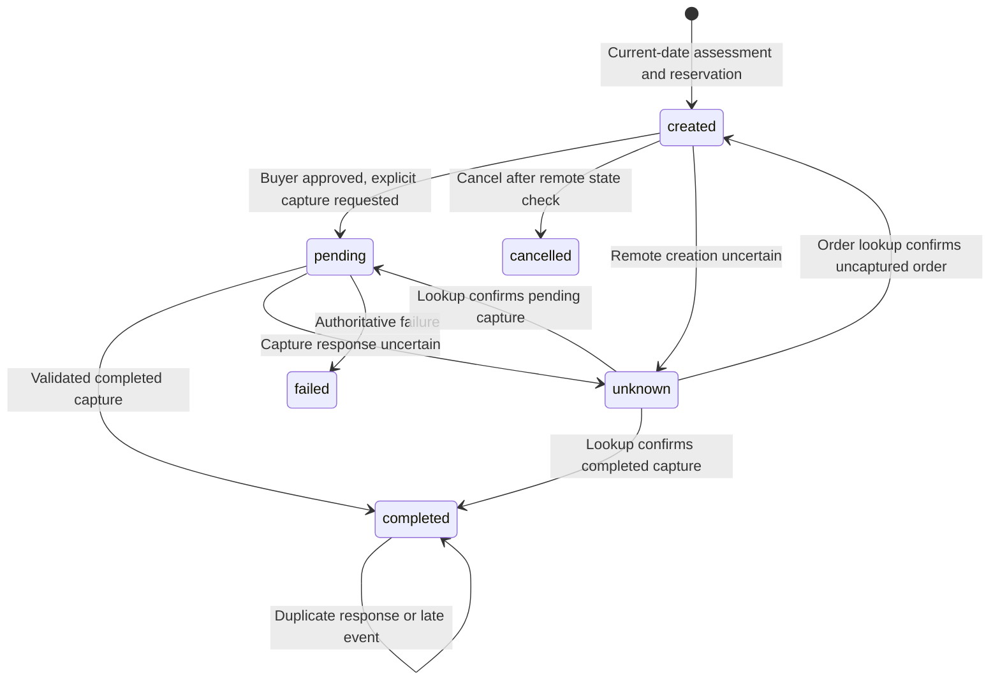

# Worth architecture

Worth is one TypeScript application: a React client, an Express server, a deterministic
financial engine shared by both, and SQLite. Claude interprets questions and chooses what to
show through read-only engine tools; its one action, preparing a checkout, is decided by server
guards. Payment execution belongs to explicit server endpoints and the user's own confirmation.

This document describes the code on `main`. The README is the short version; the
[evaluation](EVALUATION.md) and the [MCP contract](MCP.md) are separate.

## Request path

```mermaid
flowchart LR
  UI[React client] -->|JSON + X-Worth-Client| API[Express API]
  API --> Store[(Session-scoped SQLite)]
  API --> Engine[Deterministic engine<br/>shared/finance.ts]
  API --> Import[CSV normalisation]
  API --> Claude[Claude Sonnet 5.5<br/>engine tools]
  Claude --> Engine
  Claude -.prepare_checkout.-> Guards[checkoutGuards]
  API --> Guards
  Guards --> PayPal[PayPal sandbox<br/>Orders v2 · eligibility]
  API --> Channel3[Channel3 search]
  UI --> SDK[PayPal JS SDK v6<br/>button · popup · Messages]
  SDK --> Approval[Buyer approval in PayPal]
  PayPal -->|webhook, raw body| Webhook[Verify signature<br/>re-read order or refund]
  Webhook --> Store
  Agent[MCP client] -->|bearer token| MCP[/mcp]
  MCP --> Engine
  MCP --> Guards
```

In development, `server/index.ts` mounts Vite middleware in the same Express process. In
production it serves the built `dist/` client. Credentials are read by the server; the client
receives only public configuration (`state.config`: AI mode, PayPal mode, the public client ID,
the model name and the Channel3 status).

## Code map

| Module | Responsibility |
| --- | --- |
| `shared/finance.ts` | Recurrence, commitments, integer-cent forecasts, missing-data precedence, outcomes, the earliest-date search, option comparison, the illustrative Pay in 4 schedule and instalment stacking. |
| `shared/collision.ts` | Which bill or other instalment a Pay in 4 payment lands next to, and the wording for it. |
| `shared/csv.ts` | PayPal personal and business export parsing: headers, per-file date order, currency-conversion pairing, transfer/memo/hold rules, Pay in 4 proposals, transaction identity, recurring suggestions and the daily-spending estimate. |
| `shared/seed.ts` | The relative-dated sample persona (Maya) and the server-owned demo catalog (Larkspur Supply). |
| `shared/types.ts`, `shared/limits.ts`, `shared/text.ts` | API contracts, the one CSV size and row limit, and plain-text rules for saved names. |
| `server/app.ts` | Sessions, validation, routes, ownership, plan rules, checkout reservation, capture, cancel, webhooks and reconciliation. |
| `server/store.ts` | SQLite tables, atomic operations, uniqueness constraints, expiry and deletion. |
| `server/chat.ts` | The Claude tool loop, tool schemas, the answer's trace, and the deterministic local fallback. |
| `server/interpret.ts`, `server/money.ts`, `server/dates.ts` | Checks Claude's reading against the user's own words: amounts, currencies, timing phrases and which item a follow-up means. |
| `server/narration.ts` | Every sentence the user reads: verdict templates, fact catalogs, the Pay in 4 wording and `checkSentence` for Claude's one sentence. |
| `server/agentCheckout.ts` | `asksToCheckOut` (the user's own unqualified instruction) and `checkoutGuards`, shared by Ask Worth, the saved-plan Buy button and MCP. |
| `server/paypal.ts` | Sandbox OAuth, Orders v2 create/get/capture, refunds, `find-eligible-methods`, webhook signature verification and order validation. |
| `server/channel3.ts`, `server/alternatives.ts` | The Channel3 adapter (band, parsing, URL lookup, cache, back-off, limits, recorded fallback) and what Worth searches for. |
| `server/saved.ts`, `server/plans.ts`, `server/remember.ts` | Saved items and wait plans, confirmed Pay in 4 and refund schedules, and signed memory of items assessed earlier in a conversation. |
| `server/demoClock.ts` | The labelled demo clock for the sample persona (`/?replay=video`). |
| `server/mcp.ts`, `server/mcpDecision.ts`, `server/mcpStdio.ts` | The MCP server, its decision contract with coherence invariants, and the stdio relay. |
| `server/config.ts`, `server/csp.ts`, `server/limits.ts` | Environment parsing with production guards, the Content-Security-Policy, and fixed-window rate limiters. |
| `src/App.tsx` | Routing, state refresh, toasts and the `?replay=video` entry. |
| `src/Home.tsx`, `src/Ask.tsx`, `src/AskTrace.tsx` | Room to spend today, the conversation, and "How Ask Worth read this". |
| `src/Decision.tsx`, `src/BalanceChart.tsx`, `src/chartLayout.ts` | The option comparison, the Pay in 4 panel and the SVG balance chart with its label layout. |
| `src/Checkout.tsx`, `src/paypal.tsx`, `src/paypalSdk.ts` | The checkout dialog and the SDK v6 loader, button, eligibility and Messages. |
| `src/Saved.tsx`, `src/Alternatives.tsx`, `src/Activity.tsx`, `src/Reviews.tsx` | Saved items and wait plans, similar items, activity, and the "how did you pay" and refund reviews. |
| `src/Plan.tsx`, `src/Import.tsx`, `src/ForeignPayments.tsx` | The four-step plan editor, CSV import preview and unresolved foreign payments. |
| `src/ConnectAgent.tsx` | Settings → Connect an agent: create, copy and revoke MCP tokens. |
| `shared/link.ts`, `src/PasteLink.tsx` | Pasted product links: link checks, title cleaning and the "Is $X right?" card with its manual fallback. |

## Financial calculation

All money is represented as integer USD cents. A forecast starts from the confirmed funds snapshot, not from the sum of historical transactions:

```text
funds snapshot
+ confirmed dated income
- confirmed dated bills and subscriptions
- estimated everyday spending
- unreflected completed purchases and active reservations
- proposed purchase on its proposed date
```

The cushion is a comparison threshold, not another debit. Historical rows inform spending estimates and recurrence proposals; they do not reduce the current snapshot again. On refreshing funds, `reflectedPurchaseIds` explicitly records which completed app purchases are already included.

`forecast()` emits daily closing balances and intraday minima for baseline, purchase, and stress paths. On a date with unknown timing, bills, everyday spending, and purchases occur before income. `assessPurchase()` classifies using the lowest path value, retaining earlier baseline shortfalls. It returns the dates, inputs, drivers, assumptions, and profile version with the result.

Purchase dates range from today through 30 days ahead. Each candidate is assessed from today through 30 days after the purchase, for up to a 60-day span. Recurring entries repeat by their confirmed cadence; month-end recurrence remains anchored to the original calendar day. Stress spending is `ceil(dailySpendCents × 1.2)` per day, a stated assumption rather than a calibrated confidence bound.

Missing confirmation, a funds snapshot that is not for today, unconfirmed active flows, invalid amounts, or unresolved profile fields force `incomplete`. The forecast remains inspectable, but it cannot support a positive result.

The financial-picture editor separates Funds, Income, Bills & subscriptions, and Review. It validates each step, preserves drafts through Back navigation, and only writes on final Save. Review includes completed-purchase inclusion and explicit AI consent. Name/timezone are an optional disclosure; recurring items use compact rows with one editor at a time.

## CSV import

`POST /api/import/preview` and `POST /api/import/commit` take `{ csv, dateOrder? }`. The parser validates every row, leaves out memo rows and authorization holds, and pairs each USD currency-conversion leg with the foreign-currency payment it paid for (by Reference Txn ID, or, in personal exports, which have no reference, among rows within two seconds of each other; with several conversions at once, each payment pairs through the foreign-currency leg of its own amount). A paired payment, pending or completed, is recorded once at its USD cost under its own transaction ID, and never added when its USD leg is already in history. A payment left beside an unpaired USD leg is covered by that leg. The preview adds `dateOrder`, `needsDateOrder`, `leftOut`, `adjustments`, `unresolved`, `converted` and `instalmentPlans` to the counts above.

- When every slash date reads both ways, the preview returns `needsDateOrder: true` without importing anything, and the commit answers `400 DATE_ORDER_REQUIRED` until `dateOrder` is `MM/DD` or `DD/MM`.
- Completed foreign spending with no conversion is stored with the session as an unresolved payment. While any remain, the profile carries a missing-information entry that saving the plan cannot remove, so every assessment is `incomplete`. `POST /api/import/unresolved/:paymentId` resolves one with `{ amountCents }` (its USD cost, added to the imported history) or `{ oneOff: true }`; if the added cost raises the history-based daily estimate above the plan's, the user is asked to review it. A later export that pairs the payment marks it `matched` and its USD leg replaces any entered cost; resolving a payment already in history returns `409 ALREADY_IN_HISTORY`.
- Recurring suggestions carry `anchorDay` (1–31 or `last`), which `occurrence()` follows for monthly and yearly items while it agrees with `nextDate`.

## AI boundary

Ask Worth calls `claude-sonnet-5-5` through `@anthropic-ai/sdk` with a fixed system prompt
(prompt-cached) and strict tool schemas. The loop allows at most four model rounds and six tool
calls under a per-answer deadline (15 seconds by default), with no SDK retries and at most one
retry of a retryable provider error while time remains. The person's message, up to
eight prior messages and a bounded request context are sent; transaction and merchant strings
are minimised and marked as data, never instructions.

Tools, all read-only except the guarded request in `prepare_checkout`:

| Tool | What Claude reports | What the server does |
| --- | --- | --- |
| `interpret_purchase` | Items in the user's words, stated price in cents, ISO currency, quantity, whether it continues the previous item, the timing phrase copied verbatim and its date, and the option (check, earliest date, most to spend) | Checks every amount and date against the message (`server/money.ts`, `server/dates.ts`); asks instead of guessing when the price is missing, not USD, ambiguous, or the date is vague, past or beyond 30 days; then runs `assessPurchase` and, when asked, the Pay in 4 scenario |
| `list_commitments` | Subscriptions, bills or both | Lists confirmed obligations due in the next 30 days |
| `spending_summary` | — | Totals completed USD spending by category for 30 days |
| `get_plan_summary` | — | Room to spend today, the baseline low point and its cause |
| `find_alternatives` | A generic kind of item and a ceiling the user wrote | Refuses for "cheaper" about timing, payment method or services; otherwise searches Channel3 within the room today; only the outcome returns to Claude, never product names or prices |
| `prepare_checkout` | Catalog item ID, option, and whether the user said to go ahead below the cushion | Runs `checkoutGuards`; Claude receives only the outcome |

Every read tool also takes **presentation fields**: up to three facts from a fixed catalog for
that tool, a reason for each from a fixed set (`answers_question`, `explains_result`,
`shows_timing`, `shows_risk`, `adds_context`), an optional lead-in from a fixed set (including
refusals for skipping bills, credit and dipping into the cushion) and up to three follow-up
chips. The server writes each fact from engine values and drops any that do not apply. Chips
pass `chipAllowed` (short questions with no numbers and no verdict); the client also drops any
that name a price other than the item's.

**One sentence.** After the tool result, Claude is asked once (low effort, JSON output) for one
sentence of at most 30 words explaining the result, naming every amount, date, count and name
only through the placeholders the server lists for that answer. `checkSentence` in
`server/narration.ts` requires one plain ASCII sentence with known placeholders, and rejects free
numbers or number words, dates and time words, advice and judgement words, Pay in 4 when it was
not asked about or in terms that rate it, values placed against the wrong role or out of date
order, and claims that contradict the engine's outcome. On any rejection the engine's template
sentence is shown and the trace records why. The verdict sentence is always a template.

**The trace.** Each answer carries how it was read (item, price source, timing words → date),
which tool ran, the facts Claude picked with their reasons, every server check that passed or
stopped the answer, and Claude's raw placeholder sentence with whether it was accepted. The
client shows it under "How Ask Worth read this".

**Checkout.** `checkoutGuards` (`server/agentCheckout.ts`) runs in order: an explicit purchase
instruction in the user's own words (quoted or pasted text dropped, no question, no negation or
condition), a catalog item, named in the message or the item under discussion, no other active
checkout, funds confirmed today, a complete plan, the wait date reached for the wait option, the
spend-less limit for that option, and below the cushion only with the user's own go-ahead.
Creating the order then re-checks a fresh assessment and that PayPal is available. The price, currency and merchant come from the catalog. An
order prepared below the cushion is stored as needing confirmation, and capture refuses until
the user confirms that in the checkout.

**Fallback.** Without a key, on a provider error or timeout, past `CLAUDE_IP_HOURLY_LIMIT` or
`CLAUDE_DAILY_LIMIT`, or when AI sharing is off for an edited or imported plan, `fallbackReply()`
answers with labelled local calculations from the same engine and the same sentences. Only the
untouched sample plan can use Claude without opt-in.

**Categories** are a separate bounded request: `POST /api/transactions/categories` sends at most
30 minimised merchant labels with temporary aliases, without amounts, dates, transaction IDs or
profile fields. Returned aliases and category names are validated; nothing is applied until the
user applies it, and an edit never changes the confirmed daily-spending estimate.

## Pay in 4 comparison

PayPal does not tell the merchant how the buyer paid (neither the order nor the capture says),
and its schedule is set at checkout, so Worth treats Pay in 4 as a labelled comparison and a
confirmed fact afterwards, never as a prediction.

- **Eligibility.** `/api/compare` asks PayPal's `find-eligible-methods` (US buyer, USD amount)
  and caches the answer per price band; Worth's own $10–$2,000 range applies on top. If the call
  fails the comparison is shown as range-only. The browser's `findEligibleMethods` decides only
  whether to render the button and `<paypal-message>`.
- **Schedule.** `payIn4Schedule` splits the total into four whole-cent payments on days 0, 14,
  28 and 42, with any remainder on the first ($1,199.00 is 4 × $299.75). The sandbox's real
  schedule used 16-day gaps, so every date is "about".
- **Collisions.** Each payment is paired with the nearest bill, subscription or other plan's
  payment at most three days away (`shared/collision.ts`), and instalment plans already running
  in the window are reported as stacking.
- **After purchase.** A completed purchase counts at full price until the user confirms how they
  paid (`POST /api/purchases/:id/plan`); a confirmed plan replaces the debit with its remaining
  payments. Refunds arrive as review items and change nothing until confirmed.

## Balance chart

`src/BalanceChart.tsx` draws the forecast as inline SVG with no chart library:
`src/chartLayout.ts` computes the geometry and places labels without collisions. The chart shows
the daily lowest balance as a step line, the cushion, hatching below it, and every payday and
bill of $100 or more as a full-height line where it moves the balance; the two behind the
answer are drawn at full strength. A line opens a card (amount, balance after, one sentence) on
click, tap or Enter, and arrow keys move between lines. A day scrubber works with mouse, touch
and keyboard and announces through an `aria-live` region, and "View as table" lists the same
values. With Pay in 4 open, the instalment path is drawn dotted with numbered payments. Every
value is read from engine output; the chart computes no money of its own.

## Agents over MCP

`/mcp` is mounted outside `/api`: it reads only an `Authorization: Bearer wrth_…` token, never
the session cookie. Tokens are created in Settings → Connect an agent, stored as SHA-256
fingerprints with the last four characters, bound to one session's plan, capped at three per
plan, and expire with the plan or after 30 days. Three tools map existing engine functions:
`check_affordability` (a decision contract checked by `checkDecision` before it is sent),
`prepare_order` (the same `checkoutGuards`, returning an approval link and never capturing) and
`list_saved_plans`. Orders an agent requested are labelled in Activity. The MCP path makes no
Anthropic call. Limits, refusals and setup are in [MCP.md](MCP.md).

## Similar items from other stores (Channel3)

Under the Spend less option, and in Ask answers to requests for something cheaper, Worth lists up to four real products from other stores, found through Channel3. It is discovery only: rows open the store's page in a new tab, and Worth never sells them or offers PayPal checkout for them.

- **What is sent.** Only a phrase built from an allowlist of product kinds (camera, headphones, chair, desk, laptop, jacket, …) with at most one listed modifier ("office chair"), or a catalog item's fixed description. Names, brands, models and anything else typed never leave the server; with no listed kind, nothing is searched. The price band is the room today rounded down to $25, with a floor at a quarter of it. Settings and privacy names Channel3 and says this applies with the assistant off.
- **Endpoints.** `POST /v1/search` and `POST /v1/similar` (credits), and the free `GET /v1/products/{id}`. `GET /api/alternatives?productId|itemName|maxPriceCents|similarTo` sets the ceiling from the session's room today; `similarTo` works only for products this session was shown ("More like this"). `GET /api/alternatives/price?id&savedPriceCents` (`channel3.checkPrice`) reports whether a product's price dropped, for the Saved list: only for products the session was shown or saved (`app.locals.rememberAlternative`), at most 30 per session and 60 per IP per hour, with each product read cached for 15 minutes.
- **Freshness.** Rows found within 15 minutes are shown as found. Older cached rows and recorded example rows are re-read with `GET /v1/products/{id}` before display: a current price and link replace the stored ones, a product that no longer fits is dropped, and a row that cannot be re-read is listed without a price or link ("Price not checked").
- **Parsing.** Each product keeps its cheapest in-stock offer marked `new`, in USD, inside the band, linking to `buy.trychannel3.com` or the offer's own domain. Mispriced listings (another offer over three times higher) and repeats of the same model are dropped. Images are kept only on `cdn.trychannel3.com`, the one host added to `img-src`; a failed image falls back to a store icon.
- **Credits.** Results are cached 6 h per query and $25 bucket, with one request in flight per key. Live searches are capped per day (`CHANNEL3_DAILY_LIMIT`) and per client IP per hour (`CHANNEL3_IP_HOURLY_LIMIT`); cached answers do not count. After a failure, searches pause (6 h on 401/402/403, 60 s on 429, 30 s otherwise) and the recorded results in `server/fixtures/channel3.json` are served, labelled "Example results". `npm run channel3:record` refreshes them.
- **Health.** `/api/health` and `state.config.alternatives` report `channel3: ok | fixture | off`. Without a key the panel stays hidden; no error is shown.
- **Routing.** A product search runs only for a request for a cheaper or similar *product*. Questions where "cheaper" is about how or when to pay, which of Worth's options to pick, or a service plan ("Is Pay in 4 cheaper than paying now?", "Is it cheaper to wait?", "Which option is cheapest?", "a cheaper phone plan", "the cheapest way to pay") never search, while "cheaper options for headphones" and "something cheaper than the camera" do: the server refuses Claude's `find_alternatives` call for them, local mode answers them as before, and the server's fallback override applies only when Claude asked a question or summarised the plan. A priced item asked with "or something cheaper" is assessed first, then the search follows.
- **AI.** `find_alternatives` takes a kind of item and an optional ceiling the user wrote (checked against their words). The server searches and writes the answer; only the outcome (found, none found, needs an item) returns to the model, never product names, stores or prices. Without a kind of item, the answer names the limit and offers one-tap searches ("Find headphones under $300").
- **Capture.** `?capture=1` blurs product photos, titles and store names for recordings.

## Paste a product link (Channel3 lookup)

For a store that has no "Analyse with Worth" button, the shopper pastes the product link into either composer (Home or Ask Worth). Worth reads it through Channel3 and asks "Is $X right?" before it checks anything.

- **Routing.** The browser checks every composer message first (`linkIn` in `shared/link.ts`). A message holding an http(s) link never goes to `/api/chat`: one link opens the confirm card, several get "Paste one product link at a time". Link turns are also left out of the history later chat messages send.
- **Validation.** `checkProductLink` accepts only https on the default port, at most 2,048 characters, with no user name or password, on a public domain name. IP literals (v4 and v6), `localhost`, single-label hosts and private suffixes (`.local`, `.internal`, `.lan`, `home.arpa`, …) are refused, and the fragment is dropped. The browser and the server both run it.
- **No fetch by Worth.** `POST /api/lookup { url }` calls Channel3 `POST /v1/lookup { url }` (header `x-api-key`; response `{ product }`, the same Product model as `GET /v1/products/{id}`; 404 and 422 for no product page, 500 and 504 when the page could not be read). Worth's server never requests the pasted URL itself, so there is no server-side request forgery surface.
- **Mapping.** `parseLookup` returns `{ name, priceCents?, currency?, merchantName, merchantDomain, imageUrl?, sourceUrl, status }`. Only an offer on the pasted link's own domain is used, preferring an in-stock USD one; another store's price is never shown as this one's. The title is made plain text (control and bidirectional characters removed) and cut to 80 characters. Images are kept only on `cdn.trychannel3.com`. `sourceUrl` is the link as pasted, never Channel3's affiliate redirect.
- **Confirmation.** The price is never used until the shopper confirms or edits it, along with the name. With no price for this store, a price in another currency, an invalid link, Channel3 off, a failed lookup or a used-up allowance, the card becomes "We couldn't read that page. What's the price?" (or asks for the US dollar price) with name and price fields.
- **Decision.** The confirmed name and price open the usual decision, carrying `sourceUrl` and `priceSource` (`channel3` when the read price was kept, `user` otherwise). `/api/compare` echoes `source { sourceUrl, merchantName, priceSource }`, naming the store from the link's domain. It does not ask PayPal about Pay in 4, since that check answers for Worth's demo merchant: the panel reads "If this store offers PayPal Pay in 4", shown for $10 to $2,000, without PayPal's message. Saved does not keep the link yet (C6).
- **Limits.** Lookups share the search budget: the daily cap (`CHANNEL3_DAILY_LIMIT`), the per-client hourly share (`CHANNEL3_IP_HOURLY_LIMIT`) and the back-off on 401/402/403/429. A found product is cached for 15 minutes and a miss for an hour (500 and 504 for 15 minutes), with one request in flight per link. Lookups wait up to 10 seconds. A slow or unreadable page does not pause other calls.
- **Modes.** `off` answers `LOOKUP_OFF` and goes straight to the manual card. `fixture` serves the recorded lookups in `server/fixtures/channel3.json` (fictional store links on `shop.larkspur.example`: one USD price, one GBP price, one priced only at another store) and "not found" for any other link.
- **No page text to Claude.** Nothing Channel3 reads from the page is sent to Claude. If the shopper then asks a follow-up in Ask, only the confirmed item name and price travel, as the purchase under discussion, which `requestContext` passes as a quoted, minimised JSON string like any typed item name.

## Payment state and concurrency

The demo catalog is server-owned. `/api/checkout/create` accepts a product ID, not a client-provided total. It reassesses the actual current date even if the user previously explored waiting. Missing information blocks checkout; a low-cushion result requires explicit acknowledgement.

Before the remote call, the server persists one purchase reservation inside `BEGIN IMMEDIATE`. A SQLite partial unique index allows at most one active (`created`, `pending`, or `unknown`) checkout per session. A per-purchase in-process lock serializes remote reconciliation. Profile edits, imports, and reset are blocked while the active checkout needs resolution.



PayPal create/capture request IDs derive from the persisted purchase ID and are reused on retry. The gateway (`server/paypal.ts`) refreshes the OAuth token once after a 401 and retries a 429 or 5xx at most twice, with jittered exponential backoff from 300 ms (or PayPal's longer `Retry-After`), each wait capped at 2 s, and the same `PayPal-Request-Id`. Other 4xx answers are final. A timeout, network failure or body that fails to arrive is retried only for a GET or a request with a request ID. Each call has one 20 s budget for its attempts, token fetch and waits, and no retry starts with less than 3 s left, so a capture (lookup, then capture) ends within 40 s and a checkout start (eligibility, then order) within 25 s. The eligibility check is advisory: one attempt within 5 s, then the range-only fallback. Each retry is logged with PayPal's debug ID, never a body or token. Returned order identity, purchase reference, merchant, currency, amount, and capture count must match. A completed capture writes one expense and updates the profile version atomically. Order and capture IDs also have database uniqueness constraints.

`src/paypalSdk.ts` loads the sandbox JavaScript SDK v6 with bounded initialization, retryable failures, and an instance cache keyed by public client ID. The checkout dialog (`src/Checkout.tsx`) checks PayPal eligibility and creates a one-time payment session with `commit: false`. It starts in the user's click handler and passes the server order promise to preserve browser popup permission. SDK approval updates the UI; it does not capture. If SDK loading or eligibility is unavailable, the server-provided approval URL remains a redirect fallback.

After buyer approval, the user performs a distinct confirmation action in Worth. Capture revalidates the current date/profile and excludes its own reservation when recalculating affordability. If a transport failure makes the result uncertain, the allocation remains reserved. A retry fetches PayPal's order status before attempting capture again. The frontend refreshes state after uncertain creation so the outstanding checkout remains visible and recoverable after closing its dialog.

The webhook route verifies the signature through PayPal, resolves the related order, retrieves the authoritative order, and uses the same reconciliation path. Event IDs are deduplicated. Late approval events cannot downgrade a completed purchase. `PAYMENT.CAPTURE.REFUNDED` and `REVERSED` events are re-read from PayPal (`GET /v2/payments/refunds/:id`), matched to the purchase through the capture, and recorded as a review item; spending room changes only when the user confirms what came back.

## Saved items, wait plans and the demo clock

Saved items live in the session on the server (`server/saved.ts`): a catalog item (name and price from the server catalog) or a custom item from an Ask Worth assessment or a Channel3 "Similar items" row, which is labelled "Assessment only — not sold in the demo store" and never checked out. A session keeps at most 20 (the Phase 5 spec's limit, which replaces the earlier scope's "at most 5" for `save_wait_plan`). A wait plan whose date has come is reported as `ready`; there is no scheduler, email or push. On return the user confirms today's funds (`POST /api/funds/confirm`), the plan is assessed again, and only then can `POST /api/saved/:id/prepare` create the order, through `checkoutGuards` in `server/agentCheckout.ts`, the same guards Claude's `prepare_checkout` uses. A saved Channel3 row keeps its product ID (`channel3Id`) only when the session was shown that product; saving registers it with `app.locals.rememberAlternative`, and Saved checks its price once per page load through `GET /api/alternatives/price`, showing "Price dropped to $X" when it fell and nothing on any failure.

Sessions expire 24 hours after creation unless the user opts in to 30-day retention (`POST /api/retention`), which moves both the session row's expiry and the cookie's.

The demo clock (`server/demoClock.ts`) sets the session's today for the synthetic persona only: `sessionToday()` in `server/app.ts` reads it, and importing data removes it. The video replay (`/?replay=video`, `POST /api/demo-clock`) restarts the persona on Sat, Oct 3, 2026, the day the demo video was recorded. Moving the clock to a later day leaves the funds snapshot behind, so today's funds need confirming, exactly as for real data; for the untouched persona the confirmation offers the sample plan's own projected balance, and only there are the past one-time payments and completed purchases pre-ticked as already in that amount. Hand-typed numbers are the user's own, so they stay off the clock: while it runs the plan editor is locked (`PATCH /api/profile` returns `DEMO_CLOCK_RUNNING`), a plan edited before it starts cannot be moved to a later day (`DEMO_CLOCK_SAMPLE_ONLY`; the Video replay restarts the untouched sample), and an edited plan gets no projection. A purchase completed under the clock records the clock's day as `completedOn`, which "bought on" shows.

Ask Worth reads a catalog item's store price only when the message names the item as a whole phrase ("the camera", "the MacBook Pro"); "a camera bag", "a Sony camera" or "a MacBook Air" get a question about the price instead. A conversation can return to an item it assessed earlier: each reply carries that item with an HMAC tag bound to the session (`server/remember.ts`, key held in memory), the browser sends the tagged items back, and the server drops any item whose tag does not verify, so an edited or invented remembered item is never used. The tag proves Worth assessed the item, not that its price was grounded: the current-purchase `context` the browser sends is the user's own claim, like a typed price, and an item assessed from it is signed like any other.

## Session and data boundary

- Opaque random cookie: HttpOnly, SameSite=Lax, and Secure in production mode.
- `/api/state` exposes a hash-derived `sessionKey` for detecting a replaced browser session; it is not the authentication cookie. The client clears its conversation on reset, import, or detected session replacement.
- Browser chat requests include that `sessionKey`. A mismatch returns `409 SESSION_CHANGED` before calling the AI provider; the assistant clears history/context and refreshes the current plan rather than replaying old personal messages into a replacement session.
- State refreshes when the page becomes visible, on window focus, and every 60 seconds while visible, keeping dates and checkout status current. Old assessments are labelled after a profile/date change.
- Session-scoped reads and writes; possession of a different session cannot access an order through its route ID.
- Mutations require JSON and `X-Worth-Client: web`, reject cross-site fetches, and enforce the configured origin when supplied.
- Zod bounds incoming fields, amounts, dates, CSV size, history length, and scheduled flows. Per-IP requests are limited; one AI request per session can be active.
- Raw CSV is not retained. Imported normalized records remain in SQLite until reset or absolute 24-hour session expiry. Cleanup occurs before session use and on a one-minute timer.
- The database is local, single-instance storage. There is no user account recovery, encryption-at-rest layer, distributed payment lock, or production operational system.

AI consent applies to edited or imported personal context. Model tools receive relevant summaries and commitment names rather than the raw CSV. User chat and editable names can still contain personal information. Reset cannot remove data already held by PayPal, Anthropic, or operating-system backups.

## Verification

`npm run check` (lint, TypeScript, the Vitest suite and the production build) runs in GitHub
Actions on every push to `main` and every pull request. The suite covers the engine's chronology
and boundaries, CSV import rules, server ownership and reservations, capture and webhook
reconciliation with a fake gateway, the checkout guards, the sentence check as table tests, the
chart, the MCP contract and the client flows. The AI path is also replayed from recorded model
responses on every run, and run live against the real model on demand; see
[EVALUATION.md](EVALUATION.md).

Provider behaviour verified against the real sandbox, outside the suite: SDK v6 popup approval
with exactly one capture and one activity row; cancellation and recovery; a US sandbox buyer
completing Pay in 4 for $1,199 inside PayPal's checkout; PayPal Messages rendering on the US
sandbox merchant; and, on the hosted app, a capture followed by a $50 refund whose webhook was
delivered, verified and turned into a review item.

Not covered: production payments, automatic access to personal PayPal history, goods
fulfilment, more than one server instance, and encryption at rest.
