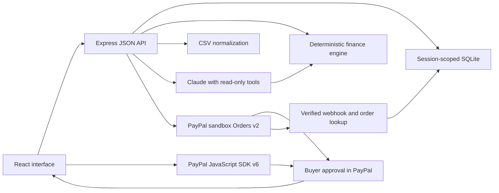
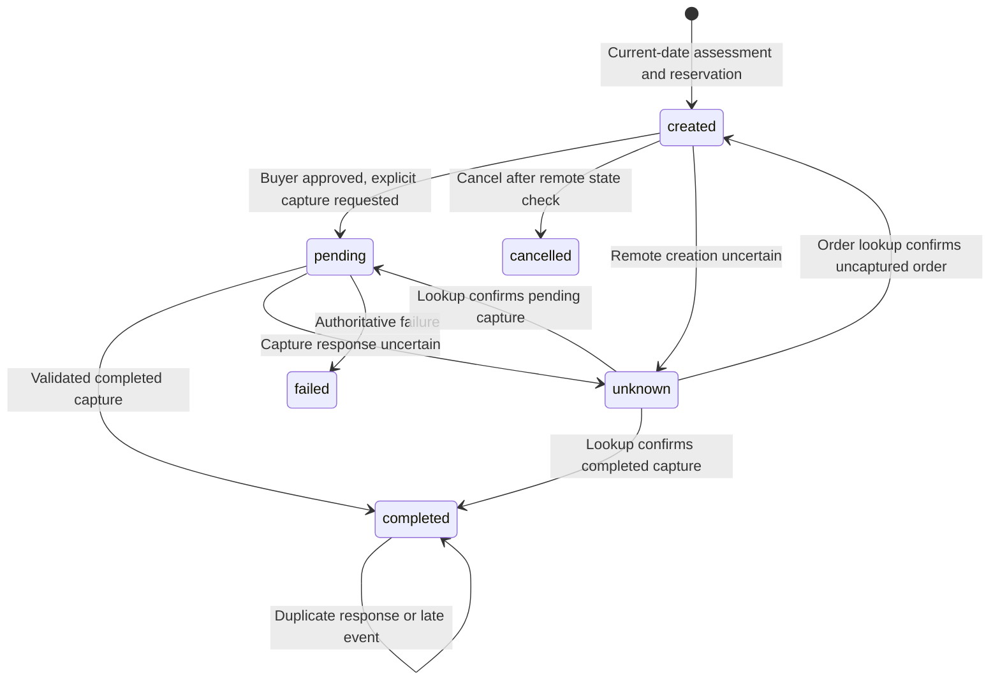

# Worth architecture

Worth is one TypeScript application: a React client, an Express server, a deterministic financial module, and a local SQLite database. The language model is an interpreter and explanation layer with read-only tools. Payment execution belongs to explicit server endpoints.

## Request path



In development, `server/index.ts` mounts Vite middleware in the same Express process. In production mode it serves the built `dist/` client. Credentials are read by the server; the client receives only public mode/configuration fields.

## Code map

| Module | Responsibility |
| --- | --- |
| `shared/types.ts` | Profile, transaction, assessment, forecast, purchase, and API response contracts. |
| `shared/finance.ts` | Date recurrence, commitments, integer-cent forecasts, missing-data precedence, outcomes, and earliest-date search. |
| `shared/csv.ts` | PayPal personal and business export headers, per-file date order, currency-conversion pairing, unresolved foreign payments, transfer/memo/hold rules, Pay in 4 proposals, transaction identity, classification, anchored recurring suggestions, and daily-spending estimate. |
| `shared/limits.ts` | The one CSV size and row limit read by the browser, the server and the parser. |
| `shared/seed.ts` | Relative-date synthetic persona and server-owned demo product catalog. |
| `server/app.ts` | Session setup, schema validation, routes, ownership checks, financial/profile rules, payment reservation, and reconciliation. |
| `server/store.ts` | SQLite tables, atomic operations, uniqueness constraints, session expiry, and deletion. |
| `server/chat.ts` | Bounded Claude tool loop, input/output validation, deterministic fallback, and authoritative numeric text. |
| `server/paypal.ts` | Sandbox OAuth, order creation/capture/get, signature verification, and order/capture amount validation. |
| `server/index.ts` | Server startup, client serving, periodic expiry cleanup, and shutdown. |
| `src/api.ts` | Same-origin JSON requests and application client header. |
| `src/paypalSdk.ts` | Bounded SDK v6 loading, per-client initialization, and one-time payment session interface. |
| `src/PlanDialogs.tsx` | Financial-picture review, explicit confirmation/AI choice, and CSV import preview, including the date-order question. |
| `src/ForeignPayments.tsx` | Activity panel for resolving imported foreign-currency payments. |
| `src/ForecastChart.tsx`, `src/CashFlowPlot.tsx` | Lazy-loaded forecast visualization; the chart payload is separate from the initial application bundle. |

## Financial calculation

All money is represented as integer USD cents. A forecast starts from the confirmed funds snapshot, not from the sum of historical transactions:

```text
funds snapshot
+ confirmed dated income
- confirmed dated bills and subscriptions
- estimated everyday spending
- unreflected completed purchases and active reservations
- proposed purchase on its proposed date
```

The cushion is a comparison threshold, not another debit. Historical rows inform spending estimates and recurrence proposals; they do not reduce the current snapshot again. On refreshing funds, `reflectedPurchaseIds` explicitly records which completed app purchases are already included.

`forecast()` emits daily closing balances and intraday minima for baseline, purchase, and stress paths. On a date with unknown timing, bills, everyday spending, and purchases occur before income. `assessPurchase()` classifies using the lowest path value, retaining earlier baseline shortfalls. It returns the dates, inputs, drivers, assumptions, and profile version with the result.

Purchase dates range from today through 30 days ahead. Each candidate is assessed from today through 30 days after the purchase, for up to a 60-day span. Recurring entries repeat by their confirmed cadence; month-end recurrence remains anchored to the original calendar day. Stress spending is `ceil(dailySpendCents × 1.2)` per day, a stated assumption rather than a calibrated confidence bound.

Missing confirmation, a funds snapshot that is not for today, unconfirmed active flows, invalid amounts, or unresolved profile fields force `incomplete`. The forecast remains inspectable, but it cannot support a positive result.

The financial-picture editor separates Funds, Income, Bills & subscriptions, and Review. It validates each step, preserves drafts through Back navigation, and only writes on final Save. Review includes completed-purchase inclusion and explicit AI consent. Name/timezone are an optional disclosure; recurring items use compact rows with one editor at a time. The assistant can show a short `intro` above its structured assessment, avoiding a second copy of the same numerical explanation.

## CSV import

`POST /api/import/preview` and `POST /api/import/commit` take `{ csv, dateOrder? }`. The parser validates every row, leaves out memo rows and authorization holds, and pairs each USD currency-conversion leg with the foreign-currency payment it paid for (by Reference Txn ID, or, in personal exports, which have no reference, among rows within two seconds of each other; with several conversions at once, each payment pairs through the foreign-currency leg of its own amount). A paired payment, pending or completed, is recorded once at its USD cost under its own transaction ID, and never added when its USD leg is already in history. A payment left beside an unpaired USD leg is covered by that leg. The preview adds `dateOrder`, `needsDateOrder`, `leftOut`, `adjustments`, `unresolved`, `converted` and `instalmentPlans` to the counts above.

- When every slash date reads both ways, the preview returns `needsDateOrder: true` without importing anything, and the commit answers `400 DATE_ORDER_REQUIRED` until `dateOrder` is `MM/DD` or `DD/MM`.
- Completed foreign spending with no conversion is stored with the session as an unresolved payment. While any remain, the profile carries a missing-information entry that saving the plan cannot remove, so every assessment is `incomplete`. `POST /api/import/unresolved/:paymentId` resolves one with `{ amountCents }` (its USD cost, added to the imported history) or `{ oneOff: true }`; if the added cost raises the history-based daily estimate above the plan's, the user is asked to review it. A later export that pairs the payment marks it `matched` and its USD leg replaces any entered cost; resolving a payment already in history returns `409 ALREADY_IN_HISTORY`.
- Recurring suggestions carry `anchorDay` (1–31 or `last`), which `occurrence()` follows for monthly and yearly items while it agrees with `nextDate`.

## AI boundary

Claude receives the current prompt and at most eight prior messages, plus relevant results from three available tools:

1. `assess_purchase` — validated amount/date to the deterministic engine.
2. `upcoming_commitments` — upcoming confirmed subscriptions and bills.
3. `spending_summary` — aggregate completed expenses by category over the last 30 days.

The loop allows at most three model calls and five tool requests, with a 25-second provider timeout and no SDK retries. Tool inputs are validated. Transaction and merchant strings are treated as data. No tool can mutate a profile or execute a payment.

The model's final response must match a small JSON shape. Narrative containing numeric/currency characters, spelled-out quantities, dates, percentages, or selected unsupported approval claims is discarded. Explicit price notation or validated purchase context establishes the amount; a product model number is not treated as a price. Authoritative amounts, dates, outcomes, and assumptions are generated from deterministic results by application code. A conservative prose filter also removes suggestions to lower the protected cushion, skip obligations, or borrow to force a purchase to fit. It may omit benign cautionary wording; engine facts remain available. These guards narrow model authority; they are not a general proof that every possible narrative is correct.

Without a key, on provider failure, or when personal-data AI consent is off, `fallbackReply()` provides visibly labelled local calculations. Only an untouched synthetic profile can use external AI without opt-in; edited demo profiles also require consent. Local language interpretation is intentionally limited.

Category suggestions are a separate bounded request: `POST /api/transactions/categories` sends at most 30 sanitized merchant labels with temporary row aliases, without amounts, dates, transaction IDs, or profile fields. Returned aliases and allowed category names are validated; nothing is applied by the model. `PATCH /api/transactions/:id` applies an explicit user correction to an owned record while preserving its amount, status, and confirmed daily-spending estimate. An active checkout blocks the edit. Imported data uses the same AI-consent gate.

## Payment state and concurrency

The demo catalog is server-owned. `/api/checkout/create` accepts a product ID, not a client-provided total. It reassesses the actual current date even if the user previously explored waiting. Missing information blocks checkout; a low-cushion result requires explicit acknowledgement.

Before the remote call, the server persists one purchase reservation inside `BEGIN IMMEDIATE`. A SQLite partial unique index allows at most one active (`created`, `pending`, or `unknown`) checkout per session. A per-purchase in-process lock serializes remote reconciliation. Profile edits, imports, and reset are blocked while the active checkout needs resolution.



PayPal create/capture request IDs derive from the persisted purchase ID and are reused on retry. Returned order identity, purchase reference, merchant, currency, amount, and capture count must match. A completed capture writes one expense and updates the profile version atomically. Order and capture IDs also have database uniqueness constraints.

`src/paypalSdk.ts` loads the sandbox JavaScript SDK v6 with bounded initialization, retryable failures, and an instance cache keyed by public client ID. `PurchaseDialog` checks PayPal eligibility and creates a one-time payment session with `commit: false`. It starts in the user's click handler and passes the server order promise to preserve browser popup permission. SDK approval updates the UI; it does not capture. If SDK loading or eligibility is unavailable, the server-provided approval URL remains a redirect fallback.

After buyer approval, the user performs a distinct confirmation action in Worth. Capture revalidates the current date/profile and excludes its own reservation when recalculating affordability. If a transport failure makes the result uncertain, the allocation remains reserved. A retry fetches PayPal's order status before attempting capture again. The frontend refreshes state after uncertain creation so the outstanding checkout remains visible and recoverable after closing its dialog.

The webhook route verifies the signature through PayPal, resolves the related order, retrieves the authoritative order, and uses the same reconciliation path. Event IDs are deduplicated. Late approval events cannot downgrade a completed purchase. Refund/reversal/denial events after a completion mark the profile for review; automatic refund accounting is outside the MVP.

## Session and data boundary

- Opaque random cookie: HttpOnly, SameSite=Lax, and Secure in production mode.
- `/api/state` exposes a hash-derived `sessionKey` for detecting a replaced browser session; it is not the authentication cookie. The client clears its conversation on reset, import, or detected session replacement.
- Browser chat requests include that `sessionKey`. A mismatch returns `409 SESSION_CHANGED` before calling the AI provider; the assistant clears history/context and refreshes the current plan rather than replaying old personal messages into a replacement session.
- State refreshes when the page becomes visible, on window focus, and every 60 seconds while visible, keeping dates and checkout status current. Old assessments are labelled after a profile/date change.
- Session-scoped reads and writes; possession of a different session cannot access an order through its route ID.
- Mutations require JSON and `X-Worth-Client: web`, reject cross-site fetches, and enforce the configured origin when supplied.
- Zod bounds incoming fields, amounts, dates, CSV size, history length, and scheduled flows. Per-IP requests are limited; one AI request per session can be active.
- Raw CSV is not retained. Imported normalized records remain in SQLite until reset or absolute 24-hour session expiry. Cleanup occurs before session use and on a one-minute timer.
- The database is local, single-instance storage. There is no user account recovery, encryption-at-rest layer, distributed payment lock, or production operational system.

AI consent applies to edited or imported personal context. Model tools receive relevant summaries and commitment names rather than the raw CSV. User chat and editable names can still contain personal information. Reset cannot remove data already held by PayPal, Anthropic, or operating-system backups.

## Verification boundaries

The verified suite has **135 passing tests**: 46 finance/CSV, 73 server, 10 frontend, and 6 financial-picture wizard cases. It covers chronology, missing inputs, import identities, ownership, reservations/reconciliation, session-change consent boundaries, conversation reset/late replies, queued prompts, SDK approve/cancel callbacks, uncertain-checkout recovery, and stepped form behavior. Type checking, the production build, and lint also pass. Mocked callbacks and payment gateways do not establish every live provider behavior.

Real provider evidence: Claude Sonnet 5.5 answered the camera question in the UI. A $349 headphones order used the approval redirect and changed purchase capacity from $850.52 to $501.52 after explicit capture. A $249 weekend order then used the SDK v6 popup; `onApprove` displayed the approval notice while Worth still held an uncaptured `CREATED` purchase. Explicit confirmation produced `COMPLETED`, exactly one matching activity row, and $252.52 remaining purchase capacity.

Desktop and 390 px mobile wizard checks confirmed step layout, Enter behavior, preserved Back edits, explicit consent and purchase inclusion, and unchanged purchase capacity after saving the restored funds snapshot. The build splits the application/chart into approximately 354/359 kB chunks (107/105 kB gzip) without the earlier chunk warning.

Real SDK cancellation was exercised separately: closing the approval flow retained a recoverable checkout; cancelling in Worth reconciled it as cancelled and restored purchase capacity. The production build passed a synthetic CSV import, recurring-confirmation gate, manual category correction with an unchanged daily estimate, and consent-off local reply. Live Claude categorization produced a reviewed correction without changing purchase capacity. External webhook delivery remains untested; its handler uses mocked gateways in tests. See the [verification ledger](BUILD.md).

React/Vite and SQLite are the selected implementation, replacing the provisional scope's framework suggestions. Native PayPal placement, automatic full consumer-history access, goods fulfillment, production money movement, and deployment remain outside this prototype. Historical data comes from CSV or synthetic fixtures.
